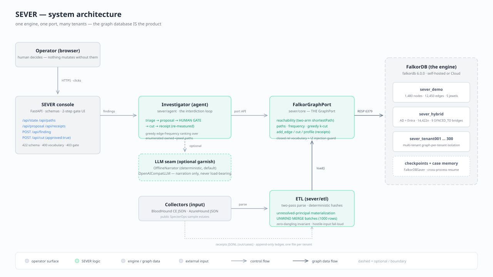
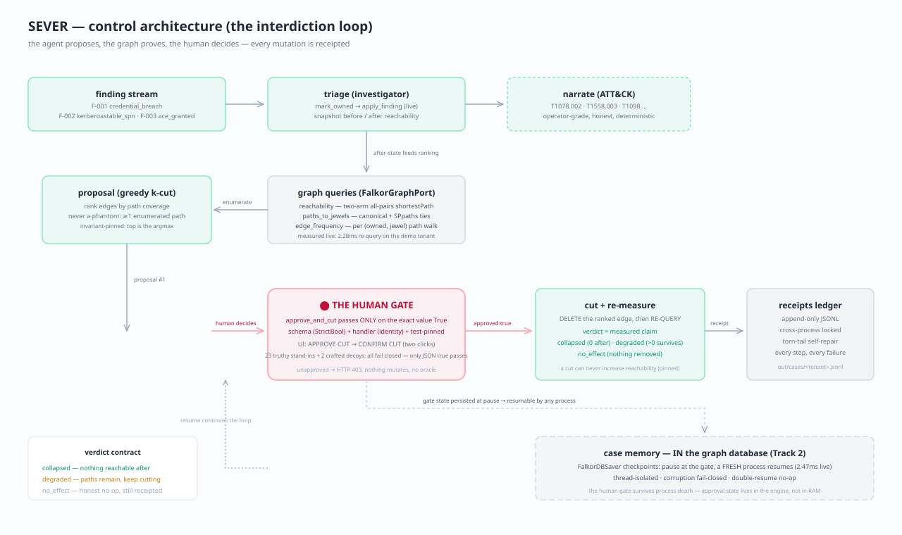
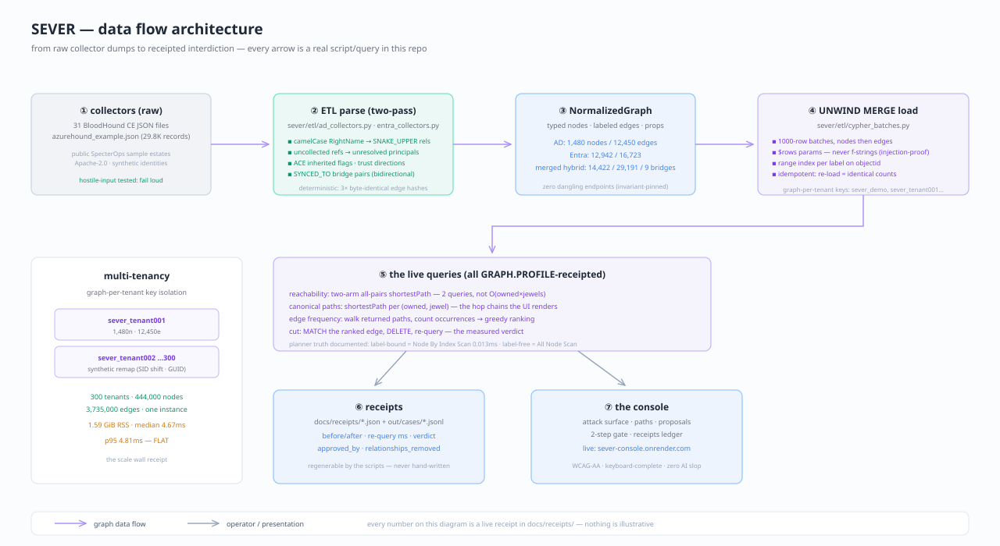
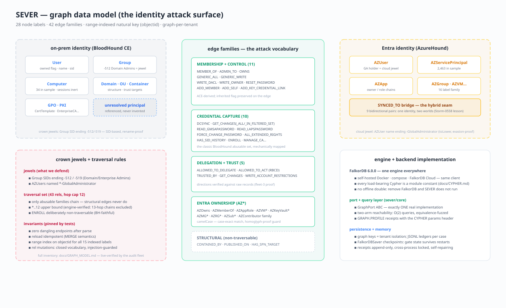
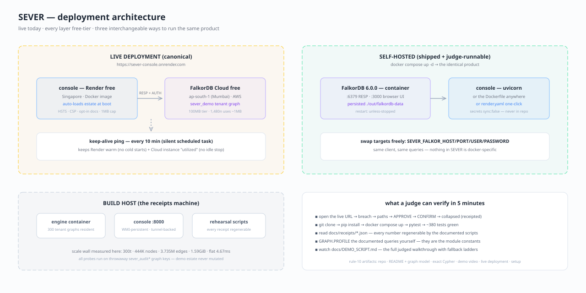

<div align="center">

# S E V E R

**Attack-path tools stop at advice. SEVER closes the loop.**

collateral-ranked cut **plans** → **human gate** → live re-query → before/after receipts — per-tenant, in milliseconds

<p>
  
  
  
  
  
</p>

**▸ LIVE: [sever-console.onrender.com](https://sever-console.onrender.com)** &nbsp;·&nbsp; engine: FalkorDB Cloud (ap-south-1)

*Built at Graph Hacks (WeMakeDevs × FalkorDB) · Oct 15–18 2026 · Tracks: Agents That Act on Connected Data (primary) · Agent Memory and Coordination*

</div>

---

An on-call identity-security agent on [FalkorDB](https://falkordb.com): it ingests
BloodHound-style Active Directory + Entra identity graphs, reacts to a live findings
stream, walks the real exploitable paths to Domain Admin, ranks the one edge whose
removal kills the most paths, and — **only after an explicit human approval** —
severs it and proves the attack surface actually collapsed.

> **Measured, not promised** — every number in this README ran on a live FalkorDB
> engine (self-hosted 6.0.0; the Cloud beat on managed 4.22.0, per its receipt) and
> is regenerable from [`docs/receipts/`](docs/receipts) by the scripts below.
> Nothing here is illustrative.

## Table of contents

1. [The four beats (measured)](#1-the-four-beats-measured)
2. [System architecture](#2-system-architecture)
3. [Control architecture — the interdiction loop](#3-control-architecture--the-interdiction-loop)
4. [Data flow architecture](#4-data-flow-architecture)
5. [Graph data model](#5-graph-data-model)
6. [Deployment architecture](#6-deployment-architecture)
7. [Real incidents this shape catches](#7-real-incidents-this-shape-catches)
8. [The console](#8-the-console)
9. [Reproduce everything](#9-reproduce-everything)
10. [How it works](#10-how-it-works)
11. [Security posture](#11-security-posture)
12. [Tests](#12-tests)
13. [Disclosures](#13-disclosures)

---

## 1. The four beats (measured)

### ▍ Beat 1 — the interdiction loop
*official BloodHound CE sample estate — 3 domains, 1,480 nodes / 12,450 edges, zero dangling*

```
breach finding → T1_TONYMONTANA owned → attack paths to 5 crown jewels light up
live ACE grant mid-stream → graph mutates on camera → agent re-scores
cut #1 (human-gated):  reachability 1 -> 1   DEGRADED — honest verdict, not the chokepoint
cut #2 (human-gated):  reachability 1 -> 0   COLLAPSED — re-query 2.28ms
```

### ▍ Beat 1½ — the remediation PLAN: approve a sequence, not one edge
*every projection measured on an isolated GRAPH.COPY — the live estate untouched by a proposal*

```
GET /api/plan → greedy k=3 cut sequence, re-enumerated on a copy after every cut
  proposal tie (4 edges, 5 attack paths each) broken by collateral:
    attacker-only edges (benign 0) rank above the shared DA-membership edge (benign 1)
  step #1: cut 2101 -[MEMBER_OF]-> 2102 · kills 5 paths · projected reachability 0 (collapsed)
POST /api/plan/execute (human-gated) → step re-measured live == projection → COLLAPSED
  estate mutates after planning? live re-measure diverges → drift_stopped_at_step —
  later steps NOT executed, re-plan demanded. Stale projections never run.
receipt: docs/receipts/plan_receipt.json (plan ~0.96s, collateral-aware proposal ~0.90s)
```

### ▍ Beat 2 — cross-process case memory *(Track 2)*
*case state lives IN the graph database — FalkorDBSaver*

```
process 1: investigation pauses at the human gate, process exits
process 2 (FRESH): resumes the same thread with zero re-explanation
  "triage was remembered from case memory: finding=F-T2"
  gated cut → 1 -> 0 in 2.47ms
```

### ▍ Beat 3 — hybrid on-prem ↔ Entra interdiction
*14,422-node merged estate · 9 bidirectional identity bridges — the MGM / Storm-0558 shape*

```
compromise the CLOUD identity of synced user Andy → 0 -> 1
  (pivots the SYNCED_TO bridge into on-prem Domain Admin chains)
sever the cross-world bridge → 1 -> 0 in 3.0ms
```

### ▍ Beat 4 — the scale wall
*FalkorDB's native multi-tenancy, made real*

```
300 tenant graphs in ONE instance · 444,000 nodes · 3,735,000 edges
engine RSS: 1.59 GiB (~5.4MB per tenant) — sparse matrices are compact
canonical shortest-path query across sampled tenants:
  median 4.67ms · p95 4.81ms · max 4.98ms — flat
```

…and the same hero arc on **FalkorDB Cloud** (free tier, Mumbai): estate loaded in
16.8s over the wire, breach 0→1, two gated cuts, COLLAPSED —
[`receipts_cloud_live.json`](docs/receipts/receipts_cloud_live.json).

---

## 2. System architecture



One engine, one port, many tenants. The console is a thin operator surface over the
`Investigator` agent; every graph operation goes through `FalkorGraphPort` — the
only `GraphPort` implementation that exists. The LLM seam is deliberately optional:
narration is garnish, Cypher does the load-bearing work, and the offline narrator
keeps the product deterministic when no model is configured.

## 3. Control architecture — the interdiction loop



The loop's honesty rules, each one pinned by live tests:

- **findings** mutate the graph (`mark_owned`, live ACE grants) — the estate is never static
- **proposals** are always real: an edge that lies on zero enumerated paths cannot be proposed
- **collateral is ranked**: coverage ties break toward *attacker-only* edges — each candidate
  receipts `benign_usage`, the number of sampled non-owned principals whose own jewel paths
  cross it (25 sampled of the estate's pool, deterministic stride; the sampled estimate is
  labeled, never passed off as an exact count). An edge that carries someone else's access
  story loses the tie; receipts say by how much. *(NoiseHound re-ranks attack paths by
  detection cost — SEVER is the remediation-side flip: rank the CUT by the disruption it
  would cause.)*
- **plans are sequences, not one edge**: `GET /api/plan` proposes a greedy k=3 cut sequence,
  every step projected on an isolated `GRAPH.COPY` of the live estate — re-enumerated and
  re-measured after each cut, never simulated from a frozen path set. The live graph is never
  touched by a proposal, and the plan stops early the moment its copy measures zero
  (no invented third step).
- **execution re-measures every step and stops at the first drift**: a plan step whose live
  re-query diverges from its projection halts the rest — later steps were computed on a
  surface that no longer exists, and stale projections never execute. `drift_stopped_at_step`
  is a status, not a failure to hide.
- **the gate** passes only on the exact value `True` — schema, handler and tests all pin it independently
- **verdicts are measured claims**: `collapsed` only when a re-query returns 0, `degraded` only when
  paths survive, `no_effect` for honest no-ops — a cut can never *increase* reachability
- **receipts** are append-only, cross-process locked, and self-repairing after a crashed writer
- **case memory** persists the gate state itself, so the human decision survives process death

## 4. Data flow architecture



Two-pass parsing with unresolved-principal materialization (never invent data the
collectors didn't give), deterministic 3×-identical edge hashes, UNWIND `$rows`
parameter binding (hostile-input fail-loud, injection-proof by construction),
idempotent MERGE loads, and range indexes on every label's natural key.

## 5. Graph data model



28 node labels · 42 edge families · graph-per-tenant isolation. The traversal set
is the core judgment: only abusable families chain, structural edges never do,
and crown jewels are SID/suffix-based so renames can't fool detection. The full
live-verified inventory, with per-family counts and derivation proofs, is in
[`docs/GRAPH_MODEL.md`](docs/GRAPH_MODEL.md); every load-bearing query is a module
constant documented in [`docs/CYPHER.md`](docs/CYPHER.md).

## 6. Deployment architecture



The live stack runs entirely on free tiers — Render (Singapore) for the console,
FalkorDB Cloud (Mumbai) for the engine — with a silent 10-minute keepalive keeping
both warm. Every layer is swappable via `SEVER_FALKOR_HOST/PORT/USER/PASSWORD`:
self-hosted compose, the shipped Dockerfile, or the one-click
[`render.yaml`](render.yaml) blueprint (secrets `sync: false` — never in the repo).
Boot is fail-fast with self-healing: an empty graph auto-loads the estate
on first boot (16.8s measured over the wire on FalkorDB Cloud —
[`receipts_cloud_live.json`](docs/receipts/receipts_cloud_live.json)),
an existing one boots without reloading — the auto-load finishes **before**
uvicorn binds its port, so Render's deploy window never races it.

**Deployment-audit honesty (2026-10-16, [`docs/AUDIT_DEPLOY.md`](docs/AUDIT_DEPLOY.md)):**
on the free plan the console's filesystem is **ephemeral — the receipts
ledger (`out/cases/*.jsonl`) resets on every deploy, restart, and spin-up**;
it scrolls post-boot actions, not history. The health check must use
`/api/health` (one cheap engine query): `/api/state` runs five engine
queries and can exceed Render's 5s health window under concurrent load,
which before the split caused an instance-restart loop (three boots in
21 minutes, each wiping the ledger) with intermittent 502s. The 10-minute
keepalive has to actually be scheduled on the demo machine (Task Scheduler
/ login item) — the repo does not start it.

**Free-tier reality, documented honestly** (per FalkorDB Cloud's own
[free-tier docs](https://docs.falkordb.com/cloud/tiers/free/) and measured live —
[`audit5_cloud_instance.json`](docs/receipts/audit5_cloud_instance.json)):

- **Lifecycle**: a free instance that goes **unutilized for 1 day is stopped,
  and is deleted after 7 days** of inactivity — no snapshots, no backups, no
  recovery. The keepalive works *through* the console: each 10-minute
  `/api/state` ping runs real engine queries (node/edge counts, jewels,
  owned set, the all-pairs shortestPath reachability), so the engine sees
  traffic, not just Render. If the keepalive and all visitors stop for a
  day, the engine stops; a stopped instance is restarted with the
  cloud console's START operation (auto-resume-on-connect is not documented
  anywhere). Because the free tier keeps no persistence, the honest reading
  is: after a stop, expect an **empty engine** — the console's boot
  auto-load then rebuilds `sever_demo` from the sample baked into the image,
  which is the actual self-heal path; anything else on the instance would
  be gone. (Render's free tier, for contrast, only sleeps the console —
  next request spins it back up in ~50s.)
- **The TLS gap**: free-tier FalkorDB Cloud has **no TLS** (TLS starts at the
  $73/mo Startup tier), so the Render→engine link is plaintext RESP over the
  public internet. What crosses it: the `AUTH` handshake (username +
  password), every Cypher query, and all graph data (the estate, the
  telemetry streams the platform writes per graph). The estate is synthetic
  public sample data and the credential is single-purpose, but the honest
  statement is: an on-path attacker can read the data and replay the
  credential. The browser→Render hop *is* TLS (Render terminates HTTPS);
  the gap is the backend leg only. Self-hosted deployments close it by
  pointing `SEVER_FALKOR_HOST` at localhost or a private network.
- **The 100MB ceiling**: `maxmemory` is exactly 100 MiB (policy
  `noeviction`). Measured live: the 1,480-node / 12,450-edge demo tenant
  costs **~4.8–5.3MB** of `used_memory` per tenant graph on the cloud
  engine (three fresh loads: 5.29/4.97/4.96MB), with the engine idling at
  ~14MB used (peak observed 31MB during the audit fleet). Headroom for the
  live demo: ~86MB. The 3,000-tenant extrapolation does **not** fit: the
  build-host receipt says 5.44MB/tenant (`scale_wall.json` — 300 tenants /
  1.594GiB on self-hosted 6.0.0), so 3,000 tenants ≈ **16.3GiB ≈ 163× the
  free-tier ceiling**; measured on the cloud engine itself it is ~15.2GB
  (≈145×). Roughly **19 tenants** fit before the wall — the multi-tenant
  scale beat is a build-host story, not a free-tier story, and the docs say
  so.

## 7. Real incidents this shape catches

[`docs/INCIDENTS.md`](docs/INCIDENTS.md) maps SEVER's beats onto real identity
attacks — each with the exact relationship chain in the graph model, the interdicting
finding/cut, and the receipt line proving it:

- **Storm-0558** (2023) — forged Entra tokens pivoting `SYNCED_TO` bridges → hybrid bridge cut, 1→0 @ 3.0ms
- **MGM Resorts** (2023) — helpdesk identity chain → ESXi ransomware → gated cut cascade, DEGRADED→COLLAPSED
- **Snowflake customers** (2024) — credential reuse across tenants → owned-node model + the 300-tenant wall
- **DCSync** — `GET_CHANGES`/`GET_CHANGES_ALL` replication rights → dcsync_right finding, exact-(src,dst) eval
- **Kerberoasting** — SPN service-ticket theft → F-002 (T1558.003), 5-of-5 proposal coverage
- **Shadow-admin ACE abuse** — live `GENERIC_ALL` grants → F-003 (T1098) live mutation, collapsed @ 2.28ms

All incident facts are web-verified and cited; graph data is the public synthetic
SpecterOps sample — the mapping is the analysis.

## 8. The console

```bash
uvicorn sever.console.app:app --host 0.0.0.0 --port 8000   # env: .env.example
```

Live attack-surface panel, breach/ACE-grant simulation buttons, hop-by-hop path
chains, and the human gate as a literal **APPROVE CUT** button — every action lands
in the receipts ledger. WCAG-AA contrast, keyboard-complete gate flow, engine-down
containment, zero AI slop. Every entry point loads a `.env` at the repo root if
present (exported variables win); all knobs live in [`.env.example`](.env.example).

**Demo video** — 3-minute walkthrough of the hero arc (breach → paths light up →
live mutation → gated cut rounds → scale wall), storyboarded in
[`docs/DEMO_SCRIPT.md`](docs/DEMO_SCRIPT.md) with timeline, click-path and fallback
ladder. A Playwright backup take: `python scripts/demo_video.py` (writes
`out/demo/sever_demo.webm`).

## 9. Reproduce everything

```bash
git clone https://github.com/choksi2212/wemakedevs-hack && cd wemakedevs-hack
docker compose up -d                       # FalkorDB 6.0.0 + browser UI at :3000
mkdir -p data/ad_sample && cd data && curl -sLO \
  https://raw.githubusercontent.com/SpecterOps/BloodHound-Docs/main/docs/assets/sample-data/ad_sampledata.zip \
  && mkdir -p entra_sample && curl -sLO \
  https://raw.githubusercontent.com/SpecterOps/BloodHound-Docs/main/docs/assets/sample-data/entra_sampledata.zip \
  && unzip -o ad_sampledata.zip -d ad_sample && unzip -o entra_sampledata.zip -d entra_sample && cd ..
pip install -e ".[dev,console,memory,agent]"  # openai ([agent]) is imported by tests/test_agent.py;
                                              # the console itself never needs it
python -m pytest                           # DB-free units run anywhere; engine tests need docker, skip cleanly
                                           # Windows note: no `unzip` — `tar -xf <zip> -C <dir>` reads the same zips
python -m pytest tests/test_live.py        # live-engine regression (docker compose up -d)
python scripts/rehearse.py                  # beat 1  (hero interdiction)
python scripts/case_memory_live.py start  --thread case-T2-live --graph sever_t2
python scripts/case_memory_live.py resume  --thread case-T2-live --graph sever_t2   # beat 2 (fresh process!)
python scripts/hybrid_live.py                                   # beat 3  (cross-world)
python scripts/scale_wall.py --tenants 300                      # beat 4  (scale wall)
python -m sever.eval.ablation                                  # ablation receipt (5/5 vs 0/5)
```

Sample data lands in `data/ad_sample` + `data/entra_sample` (both Apache-2.0
SpecterOps sample zips; see Disclosures) — the same defaults every script and test
uses, overridable via `SEVER_SAMPLE_DIR` / `SEVER_ENTRA_FILE`.

There is exactly one engine. Every beat above is the real FalkorDB Cypher from
`sever/core/falkor_port.py` — no in-memory double exists anywhere (rule 3 by
construction: **remove FalkorDB and SEVER does not run**). Only the DB-free units —
ETL parsing against the real sample, tenant generation, findings schema, human-gate
and LLM-seam semantics — execute without the engine.

## 10. How it works

```
BloodHound CE + AzureHound collectors ──▶ ETL (two-pass, BloodHound-faithful)
        │                                       │  1,480 nodes / 12,450 edges / 0 dangling
        ▼                                       ▼
 findings stream ──▶ SEVER agent ──▶ FalkorDB (graph-per-tenant)
 (breach-timeline        │  paths, scoring, proposals        │
  replay, live-mutating) ▼                                   ▼
                   HUMAN GATE ──▶ cut ──▶ re-query ──▶ receipts (JSON, ms)
```

- **FalkorDB is load-bearing** (rule 3): every path query, score, cut and re-verification
  is FalkorDB Cypher — `sever/core/falkor_port.py` holds the exact queries as module
  constants, with the engine quirks we mapped (shortestPath as a WITH-expression,
  `*..N` bounds, SPpaths' raw node ids) documented in [`docs/CYPHER.md`](docs/CYPHER.md).
- **Human gate**: `approve_and_cut()` passes *only* on the exact value `True` — no
  caller can slip a truthy value through; the console gate is an HTTP 403 without it.
  The LLM narrates; Cypher works; a human decides. (SpecterOps keeps its own agentic
  tooling read-only for the same reason.)
- **LLM seam**: any OpenAI-compatible endpoint via env config, deterministic offline
  fallback — the product never depends on a model to function.
- **Case memory**: investigations are resumable LangGraph flows checkpointed by
  `FalkorDBSaver` — state lives in the graph DB, shared across processes and agents
  (Track 2; full mapping in [`docs/T2_MEMORY.md`](docs/T2_MEMORY.md)).
- **Eval ablation**: the same estate questions answered by graph traversal (5/5) vs
  keyword-only retrieval (0/5) — the rule-3 proof, quantified:
  [`docs/receipts/ablation.json`](docs/receipts/ablation.json).

## 11. Security posture

Three adversarial audit fleets (~30 agents) hammered this product — logic invariants,
property fuzzing, mutation-tested coverage, and two dedicated pentest agents (one
external against the live deployment, one internal against code + supply chain).

- **Human gate**: 23 distinct truthy stand-ins (numbers, strings, containers,
  `None`) plus `== True` and always-truthy decoys — **all fail closed** at
  every layer (schema 422, handler identity, agent gate, flow gate); only
  literal JSON `true` opens the gate, enforced at schema *and* handler,
  both test-pinned.
- **Injection**: 39/39 hostile relationship-type payloads (homoglyphs, NFKC
  normalization tricks, zero-width, case games, metacharacters, length
  boundaries) rejected before any Cypher is built — at the port, the ETL gate
  and the HTTP schema (`tests/test_unicode_rel_guards.py`); collector data
  rides `$rows` parameters — zero hostile bytes ever reach query text.
- **DoS surface**: 1MB request-body cap (413 before buffering, on both the
  Content-Length and chunked-stream paths — `tests/test_body_size_limit.py`);
  field length caps at the schema; deep nesting rejected fast.
- **Exposure**: security headers on every response (HSTS, CSP, nosniff, DENY,
  no-referrer); OpenAPI/docs opt-in; CORS fail-closed; no cookies, no CSRF vector;
  no URL parameters anywhere (no SSRF surface).
- **Transport — the one plaintext leg**: browser→Render is TLS (Render
  terminates HTTPS), but the free-tier Render→FalkorDB Cloud leg is
  plaintext RESP (free tier ships no TLS; the managed instance's RESP port
  is public): the engine credential, every query, and all graph data cross
  it readable by an on-path observer. Demo data is synthetic/public and the
  credential is single-purpose; a real deployment closes the gap by paying
  for TLS, or by self-hosting the engine on localhost/private networking.
  Full write-up in §6 ("Free-tier reality") — kept here so the security
  posture doesn't overclaim.
- **Prompt injection**: contained and delimited — garnish renders only to the same
  operator and is never load-bearing; the HTTP console wires no LLM at all.
- **Supply chain**: pip-audit clean across the transitive closure; git history
  scanned across all refs — zero secrets ever committed (12 pattern families,
  all refs — [`docs/security_audit.md`](docs/security_audit.md)).
- **Honesty**: unknown finding kinds → 422 (never fabricated ATT&CK labels); ghost
  principals → 400; engine outages → 503 JSON with failed-attempt receipts; every
  mutation receipted; the UI labels the simulated estate on-screen.

## 12. Tests

**DB-free units (run anywhere)**: ETL parsing fidelity vs the real sample — 1,480
nodes / 12,450 edges, zero dangling — Entra overlay parsing and bridge derivation,
synthetic tenant generation, findings-stream schema + ATT&CK narration,
Cypher-injection guards, hostile-input fail-loud contracts, human-gate and LLM-seam
semantics, ledger atomicity, DOM-escape coverage.
**Engine tests (live FalkorDB; skip cleanly when it's down)**: graph-port semantics
and load counts vs the ETL, the interdiction loop with pinned invariants
(cut-never-increases, receipt==re-query, no phantom proposals, verdict coupling),
the agent loop, console API matrix, case memory, the ablation, and the live cascade
regression — gated cut rounds until reachability collapses. Plus the plan/collateral
suite (`tests/test_planning.py`): GRAPH.COPY scratch isolation, benign-usage receipts
on the sample estate (pool/sampled sizes + the attacker-only #1), an exact two-cut
plan on a synthetic engine estate — both steps attacker-only by the collateral
tie-break — execution to measured collapse, and the drift-stop honesty rule.

## 13. Disclosures

- **Simulated environment**: estates are built from the official SpecterOps
  BloodHound CE + AzureHound sample data (Apache-2.0, credited in-repo); findings
  are a labeled deterministic breach-timeline replay. No real organization's data.
  Per-tenant identities are synthetic injective remaps.
- **AI-assisted development** (rule 11): this project was built with AI assistance
  under human direction — architecture decisions, graph model, traversal semantics,
  acceptance criteria and every merge were reviewed by the author, who can defend
  each component. Commit history is fully in-window.
- **Tracks**: Agents That Act on Connected Data (primary) · Agent Memory and
  Coordination (case memory via FalkorDBSaver).

## Project layout

```
sever/etl/         collector parsing → normalized graph → Cypher batches
sever/core/        GraphPort (the one FalkorDB port), traversal semantics, scoring
sever/findings/    deterministic stream + ATT&CK narration map
sever/agent/       LLM seam + investigator loop with hard human gate
sever/memory/      resumable LangGraph flow + FalkorDBSaver case memory
sever/synth/       injective multi-tenant identity generator
sever/console/     FastAPI cockpit (human gate as an APPROVE CUT button)
scripts/           rehearse · case_memory_live · hybrid_live · scale_wall · cloud_demo
docs/              graph model · exact Cypher · demo script · incidents · live receipts
docs/assets/       the architecture diagrams above (light, color-coded SVG)
```
