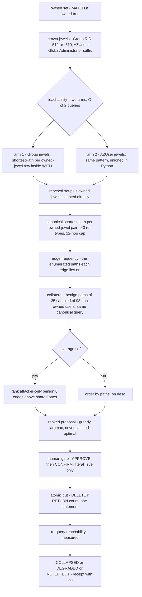

# SEVER — The Cypher Queries the Product Depends On

**TL;DR** — Rule 10 requires publishing the exact queries. These are the **live-verified**
forms, maintained as module constants in `sever/core/falkor_port.py` and
`sever/core/jewels.py`, executed against falkordb 6.0.0 (self-hosted Docker) and
re-verified form-by-form on the managed FalkorDB Cloud engine (module `graph` 4.22.0).
The interdiction pipeline they implement: jewels + owned set → two-arm reachability →
canonical path enumeration → edge scoring with a collateral tie-break → ranked proposal →
human-gated cut → measured re-query verdict.



## Provenance of every form

Executed against falkordb 6.0.0 (self-hosted Docker; case-log receipts in
`docs/receipts/receipts_live_sever_demo.json`; GRAPH.PROFILE receipt of the canonical
path query in `docs/receipts/profile.txt`, ~1.1 ms in-engine on the
1,480-node / 12,450-edge demo tenant) and re-verified form-by-form on the managed
FalkorDB Cloud engine (module `graph` 4.22.0 —
`docs/receipts/audit5_cloud_instance.json`: every shipped form parses and runs
identically on both engines) — maintained as module constants in
`sever/core/falkor_port.py` (`JEWELS_QUERY`, `AZ_JEWELS_QUERY`,
`MARK_OWNED_QUERY`, `OWNED_QUERY`, `USER_OBJECTIDS_QUERY`,
`REACHABILITY_METHOD`, `REACHABILITY_ARM_TEMPLATES`,
`PER_OWNED_REACHABILITY_ARM_TEMPLATES` (fleet-7 lineage, test-pinned),
`REACHABILITY_QUERY_TEMPLATE`, `PATH_QUERY_TEMPLATE`,
`CANONICAL_PATH_QUERY_TEMPLATE`, `CUT_ATOMIC_QUERY_TEMPLATE`, `ADD_EDGE_QUERY`,
`INDEXED_LABELS`) and `sever/core/jewels.py` (`TRAVERSAL_RELS`,
`cypher_traversal_pattern`). The audit7/perf-client round-trip folds
(`ESTATE_SNAPSHOT_QUERY` and siblings) are concatenations of these
single-purpose forms — same predicates, same aggregates, one engine
round-trip; their equivalence against the per-query forms is pinned on the
real engine by tests.

`[:REL|…]` is the abusable traversal pattern emitted by
`cypher_traversal_pattern(12)`: the **43 relationship types** of
`TRAVERSAL_RELS` (the attacker-chainable subset of the data model —
structural-only edges like `CONTAINED_BY`/`PUBLISHED_ON` are deliberately
excluded; hybrid Entra edges appear only in hybrid estates), upper-bounded
`*..12`. FalkorDB's `shortestPath` rejects lower bounds (`*1..N` throws), so
the pattern is emitted as `*..N`.

## Crown jewels

```cypher
MATCH (g:Group) WHERE g.objectid ENDS WITH '-512' OR g.objectid ENDS WITH '-519'
RETURN g.objectid AS objectid ORDER BY objectid
// Entra jewels (hybrid estates) — case-insensitive suffix match, so a
// holder named jdoe-GLOBALADMINISTRATOR is still a jewel (audit3):
MATCH (u:AZUser) WHERE toLower(u.name) ENDS WITH '-globaladministrator'
RETURN u.objectid AS objectid ORDER BY objectid
```

## Ownership (who the attacker already controls)

```cypher
// F-001, the credential breach — mark a principal owned:
MATCH (n {objectid: $oid}) SET n.owned = true
// read the owned set back (reachability iterates exactly these):
MATCH (n {owned: true}) RETURN n.objectid AS objectid
```

## Reachability (headline metric)

Count of owned principals with ≥1 bounded traversal path to any crown jewel —
the same relationship filter and hop cap as the canonical enumeration.
`REACHABILITY_METHOD` is **two-arm all-pairs shortestPath existence**: the
port runs the two `REACHABILITY_ARM_TEMPLATES` queries and unions the
reached-principal sets in Python — crown jewels span two labels (Group +
AZUser), so one arm per label. shortestPath is evaluated per (owned, jewel)
row inside the WITH clause (FalkorDB's only valid shortestPath form),
`WHERE p IS NOT NULL` keeps reached pairs and `DISTINCT` collapses to the
reached-principal set: O(2) queries instead of O(owned × jewels), and
immune to SPpaths' combinatorial tie-enumeration hang. On engines the
constructor-time `MODULE LIST` probe vouches for (falkordb >= 6.0.0) the
two arms are issued **concurrently** over the connection pool, one wall
clock instead of two (receipt: `docs/receipts/perf_audit7_client_roundtrips.json`);
every other engine runs the identical two arm templates **sequentially**
(60 s per-query timeout, fail-safe: any probe failure selects sequential).
The fleet-7 per-owned arm variant this replaced answered reach 0 with an
owned principal on the deployed Cloud twice (F900), while this two-arm
form ran green on that estate for days. A principal that is itself a crown
jewel counts as reached without a query — owning Domain Admins IS the breach:

```cypher
// arm 1 — Group jewels (RID -512 Domain Admins / -519 Enterprise Admins):
MATCH (o {owned: true}), (t:Group)
WHERE t.objectid ENDS WITH '-512' OR t.objectid ENDS WITH '-519'
WITH o, t, shortestPath((o)-{pattern}->(t)) AS p
WHERE p IS NOT NULL
RETURN DISTINCT o.objectid AS oid

// arm 2 — AZUser jewels (case-insensitive GA suffix — audit3 fixed the
// case-sensitive undercount this arm originally shipped with):
MATCH (o {owned: true}), (t:AZUser)
WHERE toLower(t.name) ENDS WITH '-globaladministrator'
WITH o, t, shortestPath((o)-{pattern}->(t)) AS p
WHERE p IS NOT NULL
RETURN DISTINCT o.objectid AS oid
```

`{pattern}` is the 43-type relationship filter with the `*..12` hop cap,
inlined from `cypher_traversal_pattern()` — byte-identical to the
enumeration pattern inlined in the next section.

**Legacy/fallback per-pair form** (`REACHABILITY_QUERY_TEMPLATE`, the
pre-fleet-7 existence probe, both endpoints `$param`-bound): kept as the
parity reference the tests pin the arm templates against and as the
live-probe form — shortestPath yields NULL (a row with `hit` = false) when
no bounded traversal path exists. On engines below 6.0.0 the product stays
on per-pair forms (`paths_to_jewels` keeps the per-pair canonical loop
there — the one form production proved on that engine family for days):

```cypher
MATCH (o {objectid: $oid}), (t {objectid: $target})
WITH shortestPath((o)-[:MEMBER_OF|GENERIC_ALL|…|AZKVContributor*..12]->(t)) AS p
RETURN p IS NOT NULL AS hit
```

The traversal set and the hop cap are enforced by the pattern itself
(live-verified: a 12-hop chain is reached, a 13-hop chain is not, a
CONTAINED_BY-only route is not) — reachability means "reachable by an
attacker-chainable relationship within the hop cap", consistent with the
paths the agent can enumerate and cut.

## Attack path enumeration

Canonical demo path — `CANONICAL_PATH_QUERY_TEMPLATE` with the full
43-type pattern inlined so it runs verbatim (milliseconds, live-measured):

```cypher
MATCH (o {objectid: $oid}), (t {objectid: $target}) WITH shortestPath((o)-[:MEMBER_OF|GENERIC_ALL|GENERIC_WRITE|WRITE_DACL|WRITE_OWNER|OWNS|FORCE_CHANGE_PASSWORD|ALL_EXTENDED_RIGHTS|WRITE_PROPERTY|RESET_PASSWORD|GET_CHANGES|GET_CHANGES_IN_FILTERED_SET|GET_CHANGES_ALL|DCSYNC|HAS_SID_HISTORY|TRUSTED_BY|ALLOWED_TO_DELEGATE|ALLOWED_TO_ACT|ADMIN_TO|ADD_MEMBER|ADD_SELF|ADD_KEY_CREDENTIAL_LINK|ADD_ALLOWED_TO_ACT|WRITE_ACCOUNT_RESTRICTIONS|READ_GMSAPASSWORD|READ_LAPSPASSWORD|MANAGE_CA|MANAGE_CERTIFICATES|GENERIC_RIGHT|EXTENDED_RIGHT|SYNCED_TO|AZOwns|AZMemberOf|AZAppRole|AZVMAdminLogin|AZVMContributor|AZVMUserAccessAdmin|AZVMAvereContributor|AZRGUserAccessAdmin|AZSubUserAccessAdmin|AZMGUserAccessAdmin|AZKVUserAccessAdmin|AZKVContributor*..12]->(t)) AS p RETURN p
```

Offline analysis mode (`paths_to_jewels(ties=True)`) enumerates tied shortest
paths via the built-in procedure (measured: cross-domain tie sets take
15–25s+ per pair — the live agent loop uses the canonical form). The
traversal set is passed server-side as `relTypes` (the full 43-type list,
inlined from `TRAVERSAL_RELS` — no user input), and the hop cap is enforced
app-side because SPpaths has no working hop-bound config. (audit5 note: until
`audit5/cloud-instance` the raw `{{…}}`-escaped template reached the engine
unformatted and was rejected deterministically on BOTH engines —
4.22.0: `Invalid input '{'`, 6.0.0: `unhandled type in inlined properties`;
`falkor_port.py` now `.format()`s it, live-verified on both):

```cypher
MATCH (o {objectid: $oid}), (t {objectid: $target})
CALL algo.SPpaths({sourceNode: o, targetNode: t,
                   relTypes: ['MEMBER_OF','GENERIC_ALL',…,'AZKVContributor'],
                   pathCount: 100}) YIELD path
RETURN path
```

## The interdiction (human-gated)

`{rel}` is the only interpolated slot in these templates. It is validated
against `^[A-Z][A-Z0-9_]{0,63}$` (`_valid_rel` in `falkor_port.py`) **before**
it can reach the query string — the Cypher injection guard; relationship
types are a closed vocabulary from the data model.

The shipped cut is **one atomic statement** (`CUT_ATOMIC_QUERY_TEMPLATE`):
the engine computes the removal count over the same `MATCH` that performs
the `DELETE`, so the receipt and the mutation can never disagree. The
previous count-then-delete pair was a TOCTOU seam under the console's
multi-client traffic: two operators cutting the same edge concurrently
could both read the pre-count (n=1) before either `DELETE` ran, so both
receipts claimed `relationships_removed=1` for one edge — the ledger
double-claimed a single removal (measured 6/6 race rounds by audit5's
multi-client harness, cross-process; rationale in the constant's comment
in `falkor_port.py`). The engine executes each command atomically, so the
single-statement form serializes: the first cutter removes and counts 1;
the second matches zero rows and honestly returns 0 → verdict `NO_EFFECT`
(live-verified on falkordb 6.0.0: the delete-return-count form returns `[[1]]`
on a match and `[[0]]` on no match, parallel edges counted per matched row).

```cypher
// the cut — only after explicit human approval (APPROVE then CONFIRM);
// one atomic statement removes the relationship and returns the count
// over the same MATCH:
MATCH (s {objectid: $src})-[r:GENERIC_ALL]->(t {objectid: $dst})
DELETE r RETURN count(r) AS n
```

## Live mutation (finding application — F-003 grants an ACE mid-demo)

Same injection guard on `{rel}`:

```cypher
MATCH (s {objectid: $src}), (t {objectid: $dst})
OPTIONAL MATCH (s)-[r0:GENERIC_ALL]->(t)
WITH s, t, count(r0) AS pre
MERGE (s)-[r:GENERIC_ALL]->(t) SET r += $props RETURN pre
```

`RETURN pre` (the edge count BEFORE the merge) is the "newly created" signal:
`RETURN count(r)` after a MERGE is 1 whether the edge was created or already
existed, so it can never report an idempotent re-grant. `add_edge` returns
True exactly when `pre == 0` (and False when an endpoint is absent).

## Remediation-plan projection substrate (audit4 — `scratch_copy`)

The multi-cut plan (`scoring.plan_cut_sequence`) projects every step on an
isolated engine-side copy of the live estate — `GRAPH.COPY`, then the same
reachability/enumeration/cut queries run against the copy, then `GRAPH.DELETE`
on it in a `finally` (a crashed plan can never leak a scratch estate):

```
GRAPH.COPY <tenant-graph> <tenant-graph>_plan_scratch
GRAPH.DELETE <tenant-graph>_plan_scratch
```

Live-verified on falkordb 6.0.0: copying the 1,480-node / 12,450-edge sample
estate measures **~0.1s**; a cut on the copy never touches the original
(pinned by `tests/test_planning.py::test_scratch_copy_is_isolated_and_droppable`).
Because the copy is a REAL graph, post-cut re-routes are visible to the
projection — a plan is never simulated from a frozen path enumeration.

The collateral estimate (benign usage) samples the estate's User principals —
deterministic order, no user input anywhere near the query:

```cypher
MATCH (u:User) RETURN u.objectid AS objectid ORDER BY objectid
```

Sampling is an even stride over the sorted non-owned pool (25 principals by
default), and each sampled principal's canonical jewel paths are enumerated
with the same `CANONICAL_PATH_QUERY_TEMPLATE` the attack ranking uses — the
benign and attack numbers are measured by the same yardstick.

## Bulk ingestion (UNWIND batches — nodes then edges, 1000 rows per batch)

Emitted by `sever/etl/cypher_batches.py` — nodes grouped by label, then
edges grouped by relationship type:


```cypher
// nodes:
UNWIND $rows AS r MERGE (n:User {objectid: r.objectid}) SET n += r.props
// edges carrying properties (props_key = JSON of the props, so prop-variants
// of the same relationship stay distinct edges):
UNWIND $rows AS e MATCH (s {objectid: e.src}), (t {objectid: e.dst})
MERGE (s)-[r:MEMBER_OF {props_key: e.props_key}]->(t) SET r += e.props
// edges with no properties:
UNWIND $rows AS e MATCH (s {objectid: e.src}), (t {objectid: e.dst})
MERGE (s)-[:MEMBER_OF]->(t)
```

## Range indexes (objectid lookups)

At the end of `load()`, a range index on the natural key is created for each
of the 15 `INDEXED_LABELS` (User, Group, Computer, Domain, OU, GPO, Container,
CertTemplate, EnterpriseCA, RootCA, AIACA, NTAuthStore, AZUser,
AZServicePrincipal, AZApp) — idempotent, an already-indexed label is skipped:

```cypher
CREATE INDEX FOR (n:User) ON (n.objectid)
```

## Engine quirks mapped during the build (all live-verified)

- `shortestPath` is only valid as a WITH/RETURN expression, not `MATCH p = …`
  (audit5 cross-check: both the WITH form and the RETURN form parse and run
  on 4.22.0 AND 6.0.0 — the shipped code keeps the WITH form; receipts:
  `audit5_cloud_instance.json`)
- `shortestPath` hop ranges must be upper-bounded (`*..N`; a lower bound such
  as `*1..N` is rejected) — hence `cypher_traversal_pattern` emits `*..N`
- `algo.SPpaths` is configured with node references, not patterns — the call
  in `PATH_QUERY_TEMPLATE` passes `sourceNode`/`targetNode`/`pathCount` plus
  `relTypes` (the 43 traversal types; live-verified honored on BOTH engines —
  a CONTAINED_BY-only pair returns 0 rows under `relTypes: ['MEMBER_OF']`).
  Unknown config keys are accepted and SILENTLY IGNORED (`maxHops: 2` still
  returns a 12-hop path), so the hop cap is enforced app-side on the parsed
  hops, and its returned paths carry raw integer node ids on edges, so hops
  are rebuilt from the ordered node list via index-zip (`_row_to_hops`).
  Previously attributed to "intermittent server-side failure under concurrent
  graph churn" ("unhandled type in inlined properties"): audit5 pinned the
  deterministic root cause — the raw unformatted template, rejected on both
  engines (see the ties-mode note above); fixed in `falkor_port.py`, and the
  live loop / reachability use only the canonical shortestPath form anyway.
- property values must be primitives or primitive arrays — FalkorDB rejects
  maps/lists, so ingest JSON-serializes list/dict property values
  (`_clean_props`), and the boolean-shaped collector flags (`IsACLProtected`,
  `IsDeleted`, `IsDC`, `DumpSMSAPassword`), which arrive list-shaped in the
  sample data, are coerced to booleans
- falkordb 6.0.0 ships `TIMEOUT_DEFAULT = 0` (no server-side kill) and
  `docker-compose.yml` carries `FALKORDB_ARGS=TIMEOUT_DEFAULT 0` only as an
  optional, commented-out knob — the client never relies on a server default
  anyway: every traversal read passes an explicit per-query timeout (60 s per
  reachability pair and scalar reads, 30 s per path enumeration)
