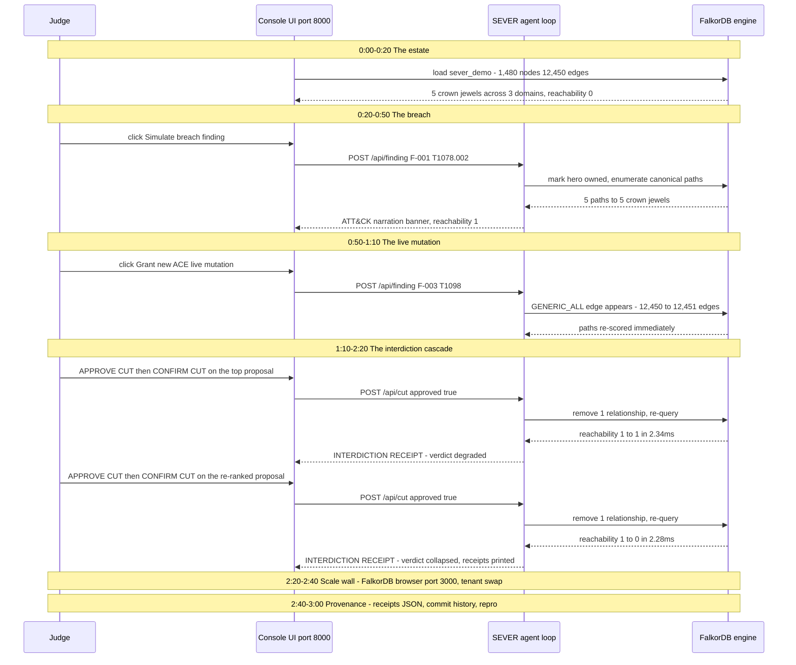

# SEVER — 3-Minute Demo Script (video storyboard)

**Thesis:** attack-path tools stop at advice. SEVER closes the loop — ranked cut →
human gate → live re-query → before/after receipts — per-tenant, in milliseconds.

> **TL;DR** — A 3-minute judge walkthrough in which every number is a receipt:
> breach → 5 paths to 5 crown jewels → gated cut **DEGRADED** (2.34ms — the honest
> verdict) → re-ranked cut **COLLAPSED** (1 → 0, 2.28ms) → plan beat projected on an
> isolated copy (~0.96s) → scale wall (300 tenants, flat 4.67ms median) → receipts
> and one-command repro. The fallback ladder has no offline double: every rung runs
> the real engine. Beat-by-beat clicks and banners: the [beat table](#beat-table--exact-clicks-expected-banners-timings) below.

## Judge walkthrough (sequence)

**Environment disclosure (shown on screen at 0:00):** simulated identity estate
built from the official BloodHound CE sample data (Apache-2.0, SpecterOps);
findings are a labeled breach-timeline replay. All data public/synthetic.

## Timeline

**0:00–0:20 — The estate.** FalkorDB browser (:3000) shows the `sever_demo`
tenant graph: 1,480 nodes / 12,450 edges ingested in seconds. Headline metric
panel: **5 crown jewels** across 3 domains; reachability 0 (nothing owned yet).

**0:20–0:50 — The breach.** Finding F-001 lands (infostealer dump —
*T1078.002*): `T1_TONYMONTANA@PHANTOM.CORP` marked owned. The graph lights up:
**5 canonical attack paths to the 5 crown jewels** (GMSA password-read
kill chain annotated hop-by-hop with ATT&CK technique labels).

**0:50–1:10 — The live mutation.** Finding F-003: a new `GENERIC_ALL` ACE is
granted mid-session — the edge appears **live** on the canvas; the agent
re-scores all paths immediately. (The canonical path query itself runs
~1.1 ms in-engine — `docs/receipts/profile.txt`.)

**1:10–2:20 — The interdiction cascade.** Agent proposes the top-frequency
edge: `GMSA_SHS_PWD -[READ_GMSAPASSWORD]-> S-…-2138`. **Human gate:
APPROVED.** Cut #1 executes → re-query → reachability **1→1 DEGRADED
(2.34ms)** — honest verdict: the top-frequency edge wasn't the chokepoint; a
parallel GMSA password-read still carries the paths. Agent re-ranks →
proposes the remaining `READ_GMSAPASSWORD` out of `GMSA_SHS_PWD`
(`S-…-2102 -[READ_GMSAPASSWORD]-> S-…-2186`; every recorded proposal edge
lies on 5 of 5 paths). **APPROVED** → cut #2 → reachability **1→0 COLLAPSED,
re-query 2.28ms**, receipts printed: before/after, re-query timing,
approvals, timestamps. (As logged in
[`docs/receipts/receipts_live_sever_demo.json`](receipts/receipts_live_sever_demo.json) —
cut #1 verdict `degraded`, cut #2 verdict `collapsed`.)

**2:20–2:40 — Scale wall.** In the FalkorDB browser UI (:3000), switch to the
`sever_tenant002` graph — a completely different org (disjoint SIDs) —
instant graph swap, native multi-tenancy.
Then the generator: hundreds of tenant graphs in ONE FalkorDB instance,
latency-flat. (FalkorDB's signature 10K-graphs-per-instance story, made real.)

**2:40–3:00 — Provenance & close.** Receipts JSON on screen; exact Cypher from
`docs/CYPHER.md`; commit history visible (all work inside the event window);
AI-assist disclosure; one-command repro (`python scripts/rehearse.py`).

## Fallback ladder (pre-recorded segments)

1. Live deploy (FalkorDB Cloud w/ heartbeat) → 2. Self-host Docker on the build
host → 3. `scripts/rehearse.py` terminal recording — the same live-engine
beats in one command. There is no offline double anywhere in the product:
every rung runs the real engine.

---

## LIVE-VERIFIED NUMBERS (Oct 15, measured on the build host — use these)

Every row is receipt-traced on this branch; the receipt file is the source of truth.

| Beat | Live-verified number | Receipt |
|---|---|---|
| Hero beat | breach → 5 canonical paths to 5 crown jewels → gated cut rounds → reachability 1 → 1 DEGRADED → 1 → 0 **COLLAPSED, re-query 2.28ms** | [`receipts_live_sever_demo.json`](receipts/receipts_live_sever_demo.json) |
| Plan beat (NEW) | `GET /api/plan` → greedy 3-cut sequence projected on an isolated GRAPH.COPY (**~0.96s**); the 4-way coverage tie (5 paths each) broken by collateral — attacker-only edges (benign 0) over the shared DA-membership edge (benign 1); `POST /api/plan/execute` → step re-measured live == projection → **COLLAPSED**; collateral-aware proposal **~0.90s** | [`plan_receipt.json`](receipts/plan_receipt.json) |
| Console arc (HTTP E2E) | breach → proposal → ONE gated cut → **1 → 0** — asserted over HTTP by `tests/test_console.py::test_approved_cut_collapses_via_console` (the cut receipt carries the re-query time) | [`tests/test_console.py`](../tests/test_console.py) |
| T2 cross-process | fresh process resumes from FalkorDBSaver case memory → "triage remembered" → gated cut → **1 → 0 in 2.47ms** | [`receipts_T2_live.json`](receipts/receipts_T2_live.json); the verbatim "triage was remembered from case memory" line: [`audit3_mem/receipts_durability.json`](receipts/audit3_mem/receipts_durability.json) |
| Hybrid | cloud identity → bridge pivot → Domain Admins; bridge severed → **1 → 0 in 3.0ms** | [`receipts_hybrid_live.json`](receipts/receipts_hybrid_live.json) |
| Scale wall | 300 tenants / 444,000 nodes / 3.74M edges in **1.59 GiB**, queries flat (median 4.67ms, p95 4.81ms) | [`scale_wall.json`](receipts/scale_wall.json) |
| PROFILE receipt | canonical path query ~1.1 ms wall-clock on the tenant, re-measured 2026-10-15; label-free point-lookup operators ~0.26 ms | [`profile.txt`](receipts/profile.txt) |

## BEAT TABLE — exact clicks, expected banners, timings

Console on the build host at `:8000`; raw graph in the FalkorDB browser UI at
`:3000`. Banner strings below are the console's verbatim UI text; every measured
number is receipt-traced (see [LIVE-VERIFIED NUMBERS](#live-verified-numbers-oct-15-measured-on-the-build-host--use-these) above).

| # | Clock | Beat | Exact click | Expected banner / visible change | Receipt / measured |
|---|---|---|---|---|---|
| 1 | 0:00–0:20 | The estate | open the console (`:8000`) | estate panel: **1,480 nodes, 5 jewels**, reachability **0** | F-001 `before` — nodes 1480 ([`receipts_live_sever_demo.json`](receipts/receipts_live_sever_demo.json)) |
| 2 | 0:20–0:50 | The breach | **Simulate breach finding** | `SIMULATED ·` `T1078.002 Valid Accounts: Domain Accounts` + narration + `reachability 0 → 1`; **5 paths** light up with hop-by-hop rel types | F-001 — 5 paths, reachability 0 → 1 (same receipt) |
| 3 | 0:50–1:10 | The live mutation | **Grant new ACE (live mutation)** | `SIMULATED ·` `T1098 Account Manipulation` + narration; the new `GENERIC_ALL` edge appears **live**, agent re-scores | F-003 — `applied: true`, edges 12,450 → 12,451 (same receipt) |
| 4 | 1:10–2:20 | Gate round 1 | **APPROVE CUT**, then **CONFIRM CUT** on the top proposal | `human gate: executing approved cut…` → `INTERDICTION RECEIPT` — removed 1 relationship(s) · reachability **1 → 1** · re-query **2.34ms** · verdict **degraded** (honest: a parallel GMSA read still carries the paths) | cut #1 — 2.34ms `degraded` (same receipt) |
| 5 | 1:10–2:20 | Gate round 2 | **APPROVE CUT**, then **CONFIRM CUT** on the re-ranked proposal (`S-…-2102 -[READ_GMSAPASSWORD]-> S-…-2186`) | `INTERDICTION RECEIPT` — reachability **1 → 0** · re-query **2.28ms** · verdict **collapsed**; before/after, approvals and timestamps print in the ledger | cut #2 — 2.28ms `collapsed` (same receipt) |
| 6 | 1:10–2:20 | Plan beat | **Plan k-cut sequence** → **APPROVE PLAN** → **CONFIRM PLAN** | `planning a k=3 cut sequence — measuring projections on an isolated copy…` → plan card with per-step measured projections + benign usage → `PLAN RECEIPT` over the verdict line **`completed`** + `executed 3 step(s) · reachability → 0 · every step matched its live re-measure` — or the drift verdict with `later steps NOT executed, re-plan needed` if the estate mutated mid-plan | [`plan_receipt.json`](receipts/plan_receipt.json) — plan **~0.96s**, collateral-aware proposal **~0.90s**, executed step re-measured `collapsed`, `plan_drift: false` |
| 7 | 2:20–2:40 | Scale wall | in the FalkorDB browser (`:3000`) switch to the `sever_tenant002` graph | instant graph swap — a completely different org (disjoint SIDs); native multi-tenancy | [`scale_wall.json`](receipts/scale_wall.json) — 300 tenants / 444,000 nodes / 3.74M edges / 1.59 GiB, median 4.67ms (p95 4.81ms) |
| 8 | 2:40–3:00 | Provenance & close | receipts ledger on screen; exact Cypher from [`CYPHER.md`](CYPHER.md); commit history; one-command repro `python scripts/rehearse.py` | every action timestamped, human-approved. Post-boot actions only: the free-tier filesystem resets the ledger on every deploy/restart, and state-probe lines interleave — a short ledger is expected, not a bug | receipts JSON beside each beat; [`profile.txt`](receipts/profile.txt) for the ~1.1ms canonical query |

The shipped demo video is [`docs/assets/sever-demo.mp4`](assets/sever-demo.mp4);
a Playwright backup take can be regenerated on demand with
`python scripts/demo_video.py` (it records the live console and writes
`out/demo/sever_demo.webm` — a gitignored output path, not a submission
artifact).
