# SEVER vs everything — the honest matrix

**TL;DR** — Every competitor cell below is a web-verified fact (linked in
[Receipts](#receipts)), not a paraphrase of our README; SEVER's own cells are receipted
in-repo, same discipline as the README. The one-sentence position: identity-path tools
stop at advice (enumeration, ranking, tickets, HTML reports) and automated containment
tools act on detection telemetry without a ranked cut, a per-action human gate, or
before/after receipts — SEVER is the entry that runs the whole loop in one engine:
findings mutate the live graph, Cypher enumerates the real paths, the one edge is
ranked, a human gates the cut, the cut executes, and the collapse is re-verified with an
ms-timed receipt. Where a competitor beats us, the matrix and
[Where SEVER honestly loses](#where-sever-honestly-loses) say so.

## Where SEVER sits: advice vs executed-and-receipted

```mermaid
flowchart TD
  subgraph ADVICE["advice-only tools - BloodHound CE, BloodHound Enterprise, ADPathFinder, NoiseHound, Tenable, MDI"]
    A1["collect and enumerate attack paths"] --> A2["rank or report choke points and findings"]
    A2 --> A3["hand remediation to humans - tickets, guidance, HTML reports"]
    A3 --> A4["verify only at the next collection cycle, or never"]
  end
  subgraph SEVERLOOP["SEVER - the executed and receipted loop"]
    S1["findings mutate the live graph"] --> S2["enumerate real exploitable paths in Cypher"]
    S2 --> S3["rank the one edge - coverage argmax with a collateral tie-break"]
    S3 --> S4["human gate in-product - APPROVE then CONFIRM, literal True only"]
    S4 --> S5["execute the cut in the engine"]
    S5 --> S6["re-query verdict - collapsed, degraded or no_effect, ms-timed receipt"]
    S6 -->|"the estate changed, re-score it"| S1
  end
  subgraph AUTO["automated containment - CrowdStrike Falcon SOAR"]
    C1["detection telemetry on live sessions"] --> C2["policy-automated containment - block login, disable account"]
    C2 --> C3["no ranked cut, no per-action human gate, no before-after receipts"]
  end
  subgraph THEORY["academic interdiction - bi-level defender-attacker MILP"]
    T1["optimal cut sets proven in-model"] --> T2["no deployed system, no engine receipts"]
  end
```

Legend: ✅ yes · ⚠️ partial / differently scoped · ❌ no · n/a — nothing to gate, column not applicable.

| Tool | collects identity graphs | enumerates attack paths | ranks edges/paths for remediation | executes the interdiction | human gate | re-verifies collapse, receipts | multi-tenant scale | case memory in-engine | self-host / open | license |
|---|---|---|---|---|---|---|---|---|---|---|
| **SEVER** (this repo) | ⚠️ no native collector — ingests BloodHound CE/AzureHound collector JSON [a] | ✅ FalkorDB Cypher, owned → crown jewels [b] | ✅ greedy single-edge coverage argmax, set-cover-family — deliberately *never* claimed optimal [c] | ✅ severs the live graph edge [c] | ✅ passes only on literal `True`; 23 truthy stand-ins + 2 crafted decoys fail closed [c] | ✅ re-query verdicts (collapsed/degraded/no_effect) + append-only, ms-timed ledger [d] | ✅ 300 tenant graphs in 1 instance measured: 444k nodes, p95 4.81ms flat [d] | ✅ FalkorDBSaver — gate state survives process death [e] | ✅ MIT; compose + Dockerfile + render.yaml | MIT |
| [BloodHound CE](https://github.com/SpecterOps/BloodHound) | ✅ SharpHound/AzureHound CE, the official collectors [1] | ✅ prebuilt + custom Cypher analyses [2] | ❌ enumeration only — choke-point prioritization is the *Enterprise* product's paid job [3] | ❌ read-only analysis | n/a | ❌ | ❌ one deployment | ❌ | ✅ open source | app Apache-2.0 [1] · SharpHound GPL-3.0 [4] |
| [BloodHound Enterprise](https://bloodhound.specterops.io/) | ✅ continuous SharpHound/AzureHound/OpenHound (AD, Entra, GitHub, Jamf, Okta) [5] | ✅ attack-path findings to Tier 0/1 [5] | ✅ **choke points** — "17,000+ paths cut per choke point" [3] | ❌ humans remediate AD via Jira/ServiceNow tickets [6] | ⚠️ decisions land in ticket workflows; no in-product gate on an executed change | ⚠️ re-collection flips findings; tickets auto-close once the finding disappears [6] | ❌ **single-tenancy per customer** — separate DB/API/UI, data never commingled [7] | ❌ | ⚠️ SaaS + paid on-prem option [8] | commercial — from $30.90/employee, $77,250 minimum [3] |
| [ADPathFinder](https://github.com/NetSPI/AD-PathFinder) (NetSPI) | ❌ consumes SharpHound/BH CE data [9] | ✅ AD + ADCS + SCCM + MSSQL paths, red-team lens [9] | ⚠️ groups findings into risk categories in HTML reports; no cut ranking [9] | ❌ | n/a | ❌ | ❌ | ❌ | ✅ open source | BSD-3-Clause [9] |
| [NoiseHound](https://github.com/warpedatom/NoiseHound) | ❌ consumes BH CE exports [10] | ✅ quietest-path solver (threshold sweep + bounded k-shortest) [10] | ⚠️ ranks paths by **lab-measured detection noise** (OPSEC), not interdiction coverage; `--defensive` ranks telemetry gaps, not edge cuts [10] | ❌ | n/a | ❌ | ❌ | ❌ | ✅ open source | MIT [10] |
| [Tenable Identity Exposure](https://docs.tenable.com/identity-exposure/SaaS/Content/User/AttackPath/attack-path-node-types.htm) | ✅ own sensors crawl AD continuously [11] | ✅ attack paths to critical assets [11] | ✅ "Top Attack Techniques" choke-point prioritization across paths [12] | ❌ guidance only | n/a | ⚠️ rescan flips path status (Done / Chain Prevented / Accepted) [12] | ❌ per-tenant SaaS; no measured many-graphs-per-instance story | ❌ | ❌ SaaS only | commercial |
| [Microsoft Defender for Identity](https://learn.microsoft.com/en-us/defender-for-identity/) | ✅ domain-controller sensors [13] | ✅ Lateral Movement Paths (LMPs), 48-hour windows [13] | ⚠️ "riskiest LMP" assessment + recommendations [13] | ❌ | n/a | ⚠️ LMPs continuously recomputed from sensor data [13] | ❌ per-tenant SaaS | ❌ | ❌ | commercial |
| [CrowdStrike Falcon Identity Protection](https://www.crowdstrike.com/en-us/resources/data-sheets/falcon-identity-threat-protection) | ⚠️ identity telemetry via one sensor — not a privilege graph [14] | ❌ detection/correlation, no path enumeration to crown jewels [14] | ❌ Charlotte AI triage ranks *detections*, not path cuts [15] | ⚠️ **executes containment** on live detections — block login / disable AD account via SOAR [15] | ❌ policy-automated; no per-action human approval | ⚠️ ongoing detection telemetry, not before/after cut receipts | ❌ | ❌ | ❌ | commercial |
| Academic interdiction formulations [16][17][18][19] | ❌ graphs are model inputs | ✅ encoded in the model | ✅ **optimal** — bi-level defender-attacker MILP with exact algorithms [16]; minimum-cost hardening [17][18] | ❌ theory; no deployed system | ❌ | ❌ (verified in-model, not in an engine) | ❌ | ❌ | n/a | public record |

## Where SEVER honestly loses

- **Optimality.** Bi-level MILP interdiction [16] and minimum-cost hardening [17][18] solve the
  cut problem *optimally*. SEVER's ranking is a greedy argmax with no approximation bound
  claimed — the re-enumerating objective (attacker-pairs disconnected) is supermodular, so no
  classic greedy guarantee applies. We chose milliseconds + auditability over optimality.
- **Collection.** BHE, Tenable and MDI run continuously on real production directories —
  including GitHub/Jamf/Okta via OpenHound [5]. SEVER ingests BloodHound CE/AzureHound
  collector output, and every number we publish ran on the public SpecterOps sample estate
  (disclosed in the README; findings are a deterministic breach-timeline replay).
- **Detection-awareness.** NoiseHound [10] scores edges by lab-measured detection telemetry;
  SEVER's ranking is pure path-coverage and is blind to how detectable an edge is.
- **Automated action at enterprise scale.** CrowdStrike [15] already executes identity
  containment automatically on real customer estate, at a scale we do not claim. We keep the
  human because our product cuts *standing* paths, not live sessions.
- **Prioritization maturity.** BHE's choke points [3] and Tenable's Top Attack Techniques [12]
  are production-hardened across hundreds of millions of paths; our greedy ran on a
  12,450-edge sample estate.

## Receipts

In-repo: [a] `sever/etl/` parses BloodHound CE/AzureHound collector JSON — no native collector.
[b] `docs/CYPHER.md` — every load-bearing query. [c] `sever/core/scoring.py` ("greedy-ranked,
never optimal, never bound") + `sever/agent/investigator.py::approve_and_cut`.
[d] `docs/receipts/` — live JSON receipts incl. the 300-tenant scale wall and the Cloud run.
[e] `docs/T2_MEMORY.md` — FalkorDBSaver, cross-process case resume.

Web: [1] github.com/SpecterOps/BloodHound (Apache-2.0) · bloodhound.specterops.io/collect-data/ce-collection/sharphound ("the official data collector for BloodHound CE"). [2] queries.specterops.io — the CE query library: enumeration, no prioritization. [3] aws.amazon.com/marketplace/pp/prodview-nne5kiarmhfwi — BHE: "prioritizes the choke points that remove the most risk with the fewest operationally safe changes"; "17,000+ paths cut per choke point"; pricing. [4] github.com/SpecterOps/SharpHound — LICENSE: GPL-3.0. [5] bloodhound.specterops.io/get-started/quickstart/enterprise-quickstart — SharpHound Enterprise / AzureHound Enterprise / OpenHound continuous collection. [6] bloodhound.specterops.io/integrations/atlassian/jira/use — findings → Jira issues; auto-closure once the finding no longer exists; also ServiceNow SIR/VR. [7] bloodhound.specterops.io/get-started/security-boundaries/enterprise-security-overview — "deployed in a single-tenancy model within AWS… data is not commingled between customers." [8] specterops-bp-2731-onprem-architecture.mintlify.app/on-premises/overview — "An on-premises deployment of BloodHound Enterprise is a self-hosted option." [9] github.com/NetSPI/AD-PathFinder — "attack mapping tool for pentesters and red teamers"; BSD-3-Clause. [10] github.com/warpedatom/NoiseHound — detection-aware path scoring, MIT; `--defensive` ranks detection controls. [11] docs.tenable.com/identity-exposure/…/AttackPath/attack-path-node-types.htm — "graph visualizing attack paths open to attackers within your Active Directory environment." [12] docs.tenable.com/exposure-management/Content/attack-path/attack-path.htm — choke points, path statuses (Done / Chain Prevented / Accepted). [13] github.com/Microsoft/ATADocs — "understand-lateral-movement-paths.md": LMP visual guides, 48h history, riskiest-LMP assessment. [14] crowdstrike.com/…/falcon-identity-threat-protection (data sheet) — real-time identity threat detection & response, no path enumeration. [15] crowdstrike.com press release (Apr 22, 2025) — "Falcon Fusion SOAR automates Active Directory actions — like disabling compromised accounts and MFA enforcement." [16] doi.org/10.1016/j.cor.2016.05.005 — *Interdicting attack graphs to protect organizations from cyber attacks: a bi-level defender-attacker model* (Computers & OR, 2016). [17] csis.gmu.edu/noel/pubs/2003_ACSAC.pdf — Noel, Jajodia, O'Berry, Jacobs, *Efficient Minimum-Cost Network Hardening via Exploit Dependency Graphs* (ACSAC 2003). [18] Wang, Noel, Jajodia, *Minimum-cost network hardening using attack graphs* (Computer Communications 29(18), 2006). [19] *Optimal Network Security Hardening Using Attack Graph Games* (IJCAI 2015). Set cover itself: NP-complete (Karp 1972), greedy H(n)-approximation (Chvátal 1979).

## The honest delta

SEVER is the only entry in this table that runs the whole loop in one engine: findings mutate
the live graph, real exploitable paths are enumerated in Cypher, the one edge whose removal
kills the most paths is ranked, **a human gates the cut in-product on the literal value `True`**,
the cut executes in the graph, and the collapse is re-verified by re-query — collapsed /
degraded / no_effect, measured before and after with millisecond timings in an append-only
receipt — while the entire case, including the pending gate decision, is checkpointed in the
same graph database via FalkorDBSaver and resumes across processes, at 300 tenant graphs in
a single instance with flat ~5ms queries. BloodHound Enterprise ranks choke points but hands
the interdiction to humans in Jira and re-verifies only at the next collection cycle; Tenable
and MDI stop at assessments; CrowdStrike executes containment but on detection telemetry, with
no ranked cut, no per-action human gate and no before/after receipts; the open-source tools
stop at enumeration or OPSEC re-ranking; academia solves the cut better than we do but ships
no system. What we deliberately do **not** claim: algorithmic novelty — the ranking is
set-cover-family greedy, documented as greedy-ranked, never optimal, never bounded; parity
with production-directory deployments — every published number ran on the public SpecterOps
sample estate; detection-awareness; and the illusion that a graph cut *is* the directory
change — a cut proves the graph collapsed; the AD change is made by the operator who approved it.
