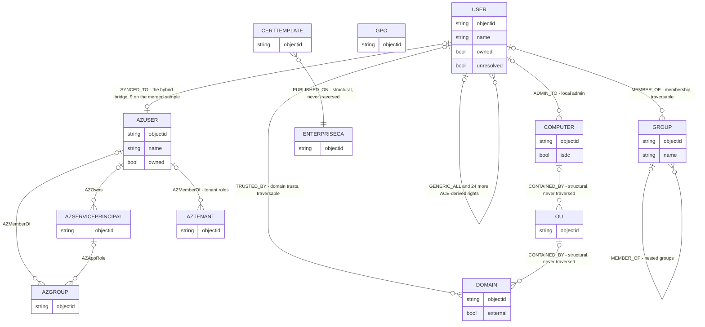
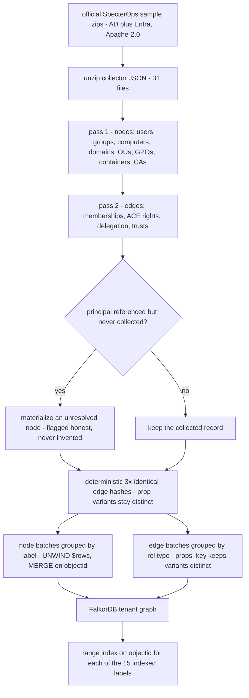

# SEVER — Graph Data Model

**TL;DR** — SEVER runs on **FalkorDB** (the load-bearing engine — remove it and the product
breaks, per the hackathon's rule 3). BloodHound CE / AzureHound collector JSON is parsed by a
deterministic two-pass ETL into **one graph per tenant** — `sever_demo`,
`sever_tenant001` .. `sever_tenantNNN` — native FalkorDB multi-tenancy. The model is 28 node
labels / 42 edge families on the loaded sample, and its core judgment is the **traversal set**:
only abusable relationship families chain into attack paths, structural edges never do.

## The model at a glance

## The ETL pipeline

Full derivation code: `sever/etl/ad_collectors.py` (two-pass parse,
unresolved-principal creation, deterministic). Measured on the official sample:
**31 collector files → 1,480 nodes / 12,450 edges, zero dangling references**
(`tests/test_etl.py`).

## Node label inventory (28 labels)

### On-prem AD surface (12 labels)

| Label | Source collector type | Key properties |
|---|---|---|
| `User` | users | objectid (SID), name, owned (bool), SPN flags |
| `Group` | groups | objectid (SID), name — **-512/-512 RIDs = crown jewels** |
| `Computer` | computers | objectid, name, isdc |
| `Domain` | domains (+ external trust targets) | objectid, name, external |
| `OU` | ous | objectid, structural hierarchy |
| `GPO` | gpos | objectid, structural hierarchy |
| `Container` | containers | objectid, structural hierarchy |
| `CertTemplate` | certtemplates | objectid, ADCS surface (ESC derivation D2) |
| `EnterpriseCA` | CAs | objectid, ADCS surface |
| `RootCA` | CAs | objectid, ADCS surface |
| `AIACA` | CAs | objectid, ADCS surface |
| `NTAuthStore` | CAs | objectid, ADCS surface |

### Hybrid Entra surface (16 labels — the `_KIND_LABELS` set)

| Label | Role in the model |
|---|---|
| `AZUser` | cloud identity; **role holders are crown jewels** (name ends `-GlobalAdministrator`, case-insensitive) |
| `AZServicePrincipal` | service principal ownership chains (`AZOwns`, `AZAppRole`) |
| `AZApp` | application objects |
| `AZGroup` | cloud group membership (`AZMemberOf`) |
| `AZRole` | Entra roles |
| `AZDevice` | enrolled devices |
| `AZVM` | compute surface (`AZVMAdminLogin` and friends) |
| `AZVMScaleSet` | compute surface |
| `AZResourceGroup` | `AZRGUserAccessAdmin` |
| `AZSubscription` | `AZSubUserAccessAdmin` |
| `AZManagementGroup` | `AZMGUserAccessAdmin` |
| `AZKeyVault` | `AZKVUserAccessAdmin`, `AZKVContributor` |
| `AZLogicApp` | automation surface |
| `AZFunctionApp` | automation surface |
| `AZAutomationAccount` | automation surface |
| `AZTenant` | tenant root |

All AZ labels are keyed by the Entra object `id` instead of a SID. The 16-label
`_KIND_LABELS` set is verified present in the loaded hybrid sample.

**Every node** carries: `objectid` (natural key, MERGE target), `owned`
(compromised flag), `unresolved` (true when the node was created for a
referenced-but-uncollected principal — surfaced honestly, BloodHound-faithful).

## Edge family inventory (42 families in the loaded hybrid sample)

ACE rights are derived from per-record `Aces[]` lists; memberships from `Members[]` /
`PrimaryGroupSID`; each maps 1:1 to a relationship type.

### Membership & forest structure

| Relationship | From → To | Traversable? |
|---|---|---|
| `MEMBER_OF` | principal → group (nested groups included) | ✅ yes |
| `TRUSTED_BY` | domain → domain (incl. external trust targets, created as `external` Domain nodes) | ✅ yes |
| `CONTAINED_BY` | principal → OU/Domain | ❌ structural, never |
| `PUBLISHED_ON` | cert template → enterprise CA that publishes it | ❌ structural, never |

### ACE-derived rights (RightName → relationship type)

`GENERIC_ALL`, `GENERIC_WRITE`, `WRITE_DACL`, `WRITE_OWNER`, `OWNS`,
`FORCE_CHANGE_PASSWORD`, `ALL_EXTENDED_RIGHTS`, `WRITE_PROPERTY`, `RESET_PASSWORD`,
`GET_CHANGES`, `GET_CHANGES_IN_FILTERED_SET`, `GET_CHANGES_ALL`, `DCSYNC`,
`ADD_MEMBER`, `ADD_SELF`, `ADD_KEY_CREDENTIAL_LINK`, `ADD_ALLOWED_TO_ACT`,
`WRITE_ACCOUNT_RESTRICTIONS`, `READ_GMSAPASSWORD`, `READ_LAPSPASSWORD`, `MANAGE_CA`,
`MANAGE_CERTIFICATES`, `ENROLL`, `WRITE_PKIENROLLMENT_FLAG`, `WRITE_PKINAME_FLAG` —
(`ENROLL` and the two `WRITE_PKI*` flag writes are emitted by the sample's
cert-template ACLs but deliberately non-traversable; audit2 live inventory on
falkordb 6.0.0: 42 rel types in the loaded hybrid sample, the sample emits exactly
22 ACE-derived types, these two included). Plus the derived container-inherited
control rights `GENERIC_RIGHT` and `EXTENDED_RIGHT` (`sever/core/jewels.py`) —
traversable.

### Delegation / local admin

| Relationship | Meaning | Traversable? |
|---|---|---|
| `ALLOWED_TO_DELEGATE` | Kerberos delegation | ✅ yes |
| `ALLOWED_TO_ACT` | resource-based constrained delegation | ✅ yes |
| `ADMIN_TO` | local admin on a computer | ✅ yes |
| `HAS_SID_HISTORY` | SID-history pivot | ✅ yes |
| `HAS_SPN_TARGET` | SPN target linkage | ❌ emitted, not attacker-chainable |

### Hybrid Entra edges + the bridge

`AZOwns`, `AZMemberOf`, `AZAppRole`, `AZVMAdminLogin`, `AZVMContributor`,
`AZVMUserAccessAdmin`, `AZVMAvereContributor`, `AZRGUserAccessAdmin`,
`AZSubUserAccessAdmin`, `AZMGUserAccessAdmin`, `AZKVUserAccessAdmin`,
`AZKVContributor`, … plus the **hybrid bridge**: `SYNCED_TO`, added bidirectionally
for every `AZUser` whose `onPremisesSecurityIdentifier` matches an on-prem `User`
(the pivot cloud → on-prem; measured: 9 bridges on the merged 14,422-node sample
estate, `tests/test_entra.py`). Entra crown jewels are `AZUser` role holders
(name ends `-GlobalAdministrator`, matched case-insensitively — a holder
named `jdoe-GLOBALADMINISTRATOR` is still the jewel).

## The traversal set (the product's core judgment)

An attacker can chain only relationships in `sever/core/jewels.py::TRAVERSAL_RELS` —
the **43-type abusable subset** (memberships, ACL rights, delegation, GMSA/LAPS
password reads, trusts, the derived container-inherited control rights, and the
hybrid Entra edges), upper-bounded at 12 hops. Structural edges
(`CONTAINED_BY`, `PUBLISHED_ON`) never count toward attack paths, and the emitted
`ENROLL` / `WRITE_PKI*` / `HAS_SPN_TARGET` edges never chain either. This mirrors
BloodHound's abuse semantics for every right present in the sample.

| Family | Traversable | Never traversed |
|---|---|---|
| Memberships & trusts | `MEMBER_OF`, `TRUSTED_BY` | — |
| ACE-derived | the abusable rights above + `GENERIC_RIGHT`, `EXTENDED_RIGHT` | `ENROLL`, `WRITE_PKIENROLLMENT_FLAG`, `WRITE_PKINAME_FLAG` |
| Delegation / local admin | `ALLOWED_TO_DELEGATE`, `ALLOWED_TO_ACT`, `ADMIN_TO`, `HAS_SID_HISTORY` | `HAS_SPN_TARGET` |
| Structural | — | `CONTAINED_BY`, `PUBLISHED_ON` |
| Hybrid | `SYNCED_TO` + the AZ edges | — |

The exact 43-type list, inlined as it runs, is in [`docs/CYPHER.md`](CYPHER.md).

## Metrics

- **Reachability** (headline): count of `owned` principals with any traversal-chain
  ≤ 12 hops to a crown jewel (`Group` with RID -512 Domain Admins / -519 Enterprise
  Admins; an owned principal that is itself a crown jewel counts as reached — the
  0-hop breach). The hop cap is live-verified inclusive: a 12-hop chain is
  reachable, a 13-hop chain is not.
- **Path frequency** (scoring input): per (owned → jewel) pair, one canonical
  shortest path is enumerated (ties off); each edge is scored by the number of
  these paths it lies on.
- **Interdiction**: cut the top-frequency edge → re-query reachability → before/after
  receipt with `GRAPH.PROFILE` timing. k=1 is the exact argmax of enumerated-path
  coverage — which is not the same as collapsing reachability (tied/alternative
  routes survive; the receipt says DEGRADED when they do). k>1 re-enumerates after
  each cut and picks the exact single-edge coverage argmax again: we say
  "greedy-ranked", never "optimal" and never "approximation bound" — the
  re-enumerating sequence optimizes pairs-disconnected (supermodular, no greedy
  guarantee; the classic (1−1/e) bound applies only to a frozen path set, which
  live receipts deliberately do not use). Optimal multi-edge interdiction is
  NP-hard: Israeli & Wood 2002; AAAI'22 arXiv:2112.13175.

## Multi-tenancy

`sever/synth/tenants.py` remaps identities injectively per tenant (SID subauthority
stride 10^15, uuid5 GUID namespaces) — tenants share zero objectids, structure and
crown-jewel counts are preserved, regeneration is deterministic
(`tests/test_synth.py`).
