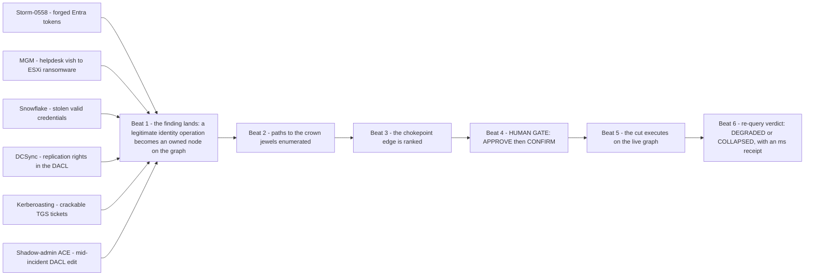
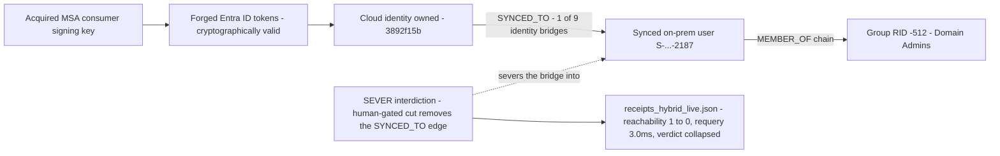
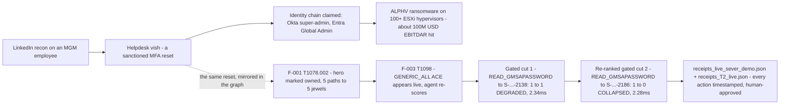
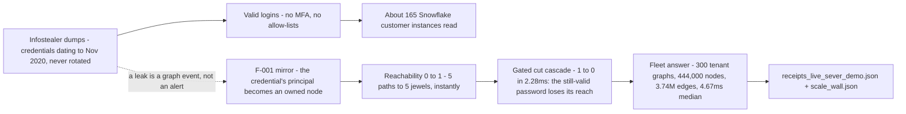
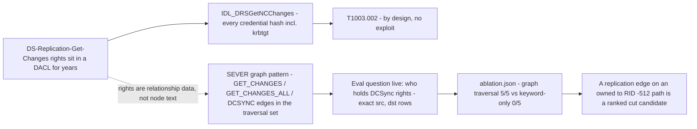
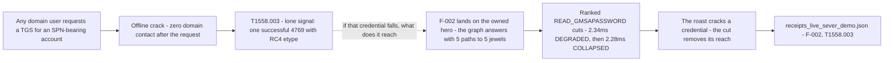
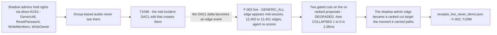

# SEVER × Real Incidents — the attack narrative

> **Ground truth, stated up front.** SEVER's graph data is the public SpecterOps BloodHound CE sample estate
> (Apache-2.0 — synthetic): 1,480 nodes / 12,450 edges per on-prem tenant, 14,422 nodes / 29,191 edges merged
> hybrid. The incidents below are **real**; the mapping — which SEVER beat interdicts each kill chain, with
> the receipt line proving it ran — is **the analysis**. No real victim data ships in this repo; every
> receipt number below was re-verified against the JSON on this branch.

> **TL;DR** — Six kill chains, one shared failure: every attacker step was a *legitimate
> identity operation*, so detection had nothing to see. Each section maps the real incident
> onto SEVER's loop — the graph pattern, the human-gated cut, and the receipt that proves it
> ran (Storm-0558 bridge cut 1 → 0 in 3.0ms; MGM cascade 2.34ms `degraded` → 2.28ms
> `collapsed`; Snowflake answered at fleet scale — 300 tenants, 4.67ms median; DCSync: graph
> 5/5 vs keyword 0/5; Kerberoasting and shadow-admin: the cut removes the reach the cracked
> credential was about to use). Per-incident diagrams: attack path → interdiction moment.

## The interdiction thesis

Every incident below beat detection the same way: the attacker's actions were legitimate identity
operations — a sanctioned helpdesk reset, a valid token, a valid password, a sanctioned ACL edit, a
permitted replication call. Detection waits for something to *look wrong*. SEVER doesn't wait: the graph
already knows who can reach Domain Admins; when the identity fabric mutates mid-incident it re-scores
every path and proposes the one edge carrying the most of them. Human approves. Cut. Re-query. Receipt.
Detection asks "did anything look odd?"; interdiction asks "does the attacker still have a path?"

### The one loop every incident hits

## 1. Storm-0558 (2023) — forged Entra tokens, the hybrid pivot
**(a) Incident.** Storm-0558 (China-based) used an acquired MSA consumer signing key to forge Entra ID
tokens and read Exchange Online mail of ~25 organizations (22 enterprise tenants, 503 personal accounts)
from May 15, 2023 — Microsoft learned of it from a *customer report* on June 16 (Microsoft Security Blog,
Jul 14, 2023; DHS CSRB review, Mar 2024). A cloud identity fell; every hybrid tenant asked the graph
question: *does a compromised synced identity reach on-prem Domain Admins?*
**(b) Graph pattern.** SEVER's hybrid beat is that shape: owned `AZUser` (`3892f15b-…-f49761`) —`SYNCED_TO`→
on-prem `User` (`S-…-2187`) —`MEMBER_OF`→ … → `Group` RID -512; every cross-world path rides the identity
bridge. Estate: 14,422 nodes / 29,191 edges / 9 `SYNCED_TO` bridges (`receipts_hybrid_live.json`).
**(c) Interdiction.** Sever the compromised user's `SYNCED_TO` edge (`relationships_removed: 1`) →
reachability **1 → 0**, `requery_ms: 3.0`, `verdict: "collapsed"`
(`receipts_hybrid_live.json::bridge_cut_receipt`).
**(d) Why detection missed it.** Forged tokens are cryptographically valid — no exploit, no failed auth,
no beacon; Microsoft found out from a customer a month late. Interdiction needs no anomaly: the graph
makes the jewels unreachable.

### Attack path → SEVER interdiction

## 2. MGM Resorts (2023) — helpdesk vish → identity chain → ESXi ransomware
**(a) Incident.** Scattered Spider (UNC3944) found an MGM employee on LinkedIn, phoned the IT help desk
for an MFA reset, then claimed Okta super-admin and Entra Global Admin rights; ALPHV/BlackCat deployed
ransomware claiming 100+ ESXi hypervisors on Sept 11, 2023 (BleepingComputer, Sept 14, 2023). MGM's 8-K
puts the hit at ~$100M Adjusted Property EBITDAR plus <$10M one-time expenses (SEC, Oct 2023).
**(b) Graph pattern.** F-001 (`credential_breach`, T1078.002) marks the hero (`S-…-2110`) owned → 5
canonical shortest paths to 5 crown jewels across 3 domains light up: hero -`GENERIC_ALL`→ `S-…-2101`
-`MEMBER_OF`→ `S-…-2102` -`READ_GMSAPASSWORD`→ `S-…-2138` -`MEMBER_OF`→ RID -512. F-003 then mutates the
graph mid-session — a `GENERIC_ALL` ACE appears (edges 12,450 → 12,451), agent re-scores live
(`receipts_live_sever_demo.json`).
**(c) Interdiction.** Gated cut cascade: cut #1 `S-…-2102 -READ_GMSAPASSWORD→ S-…-2138` → **1 → 1
`degraded`, 2.34ms** (honest — a parallel GMSA read still carried the paths); re-ranked cut #2 →
`S-…-2186` → **1 → 0 `collapsed`, 2.28ms**. Cross-process case memory resumes `case-DB-01` and lands its
gated `MEMBER_OF` cut **1 → 0 in 2.47ms** (`receipts_T2_live.json`).
**(d) Why detection missed it.** Every step was a sanctioned business action by an MFA-verified
"employee"; MGM pulled its Okta sync servers *reactively*, after the attackers were inside. The graph
answers before detection fires: what does this reset put in play, and which edge kills it.

### Attack path → SEVER interdiction

## 3. Snowflake customers (2024) — credential reuse, no MFA
**(a) Incident.** UNC5537 logged into ~165 Snowflake customer instances with infostealer-stolen
credentials (VIDAR, RISEPRO, REDLINE, Raccoon, Lumma, MetaStealer output) — some dating to Nov 2020, none
rotated, no MFA, no network allow-lists; 79.7% had prior credential exposure. Earliest observed
intrusion: April 14, 2024 (Mandiant, Jun 10, 2024).
**(b) Graph pattern.** F-001's mirror: a leaked credential is not an alert, it is an `owned` node —
reachability 0 → 1, 5 paths to 5 jewels, instantly (`receipts_live_sever_demo.json`). Fleet scale is the
MSSP answer: 300 tenant graphs / 444,000 nodes / 3,735,000 edges / 1.594 GiB RSS, path queries flat at
median 4.67ms (`scale_wall.json`).
**(c) Interdiction.** Credential exposure becomes a graph event: own the node, recompute, cut what
carries the paths — the receipted loop (cut #2: 1 → 0 in 2.28ms) that makes a still-valid stolen password
worthless.
**(d) Why detection missed it.** Valid credentials logging in are the definition of nothing-to-alert-on;
four-year-old infostealer logs kept working. Interdiction needs no anomaly — it needs the login's reach
to be zero.

### Attack path → SEVER interdiction

## 4. DCSync — replication rights nobody watches (classic BloodHound chain)
**(a) Incident (technique class).** Anyone holding `DS-Replication-Get-Changes` (GUID `1131f6aa-…`) and
`DS-Replication-Get-Changes-All` (`1131f6ad-…`) on the domain object can call `IDL_DRSGetNCChanges` and
pull every credential hash including krbtgt — by design, no exploit (MITRE ATT&CK T1003.002).
BloodHound's "Find Principals with DCSync Rights" exists because these rights hide in DACLs for years;
the notorious holder is the Entra Connect sync account, granted `GetChanges`/`GetChangesAll` for
password-hash sync.
**(b) Graph pattern.** In SEVER the right is an edge, not a text attribute: `principal -GET_CHANGES |
GET_CHANGES_ALL | DCSYNC→ Domain` sits in the traversal set (`docs/GRAPH_MODEL.md`); the `dcsync_right`
finding narrates T1003.002 (`sever/findings/attack_map.py`).
**(c) Interdiction.** The ablation receipt answers "Who holds DCSync rights?" with exact (src, dst)
enumeration — graph 5/5, keyword 0/5: *"ACE rights are relationship data, not node text"* (`ablation.json`).
A replication edge on an owned → -512 path is a ranked cut candidate.
**(d) Why detection missed it.** Event 4662 fires only when DCSync is *executed*; the right sits silently
in the DACL until game over. The graph sees the right before anyone uses it.

### Attack path → SEVER interdiction

## 5. Kerberoasting → F-002 (T1558.003)
**(a) Incident (technique class).** Any authenticated domain user can request a TGS for any SPN-bearing
account and crack it offline — no failed logons, no lockouts, zero domain contact after the request; lone
signal a successful 4769 with RC4 etype (MITRE ATT&CK T1558.003).
**(b) Graph pattern.** F-002 (`kerberoastable_spn`) lands on the owned hero: SPN exposed, and the graph
answers the question the roast forces — *if that credential falls, what does it reach?* 5 paths to 5
jewels; every recorded proposal edge lies on 5 of 5 (`receipts_live_sever_demo.json`, F-002, `T1558.003`).
**(c) Interdiction.** The ranked chokepoint edges — the `READ_GMSAPASSWORD` cuts — make the roasted
credential useless even after it cracks: gated cuts → 2.34ms `degraded`, then **2.28ms `collapsed`**
(same receipt).
**(d) Why detection missed it.** Cracking happens offline, far from the domain; the request itself is
legitimate Kerberos. Interdiction assumes the credential falls and removes what it was going to reach.

### Attack path → SEVER interdiction

## 6. Shadow-admin ACE abuse → F-003 (T1098)
**(a) Incident (technique class).** Shadow admins hold privileged rights via direct ACEs — `GenericAll`,
`ResetPassword`, `WriteMembers`, `WriteOwner` — not via admin-group membership, so group-based audits
never see them (CyberArk ACLight). ATT&CK T1098 (Account Manipulation) is the mid-incident DACL edit that
creates them.
**(b) Graph pattern.** F-003 live: a `GENERIC_ALL` ACE granted mid-session appears as a new edge on the
canvas (`applied: true`, edges 12,450 → 12,451) and the agent re-scores immediately
(`receipts_live_sever_demo.json`, F-003, `T1098`).
**(c) Interdiction.** Post-mutation cascade: two gated cuts on the re-ranked proposals → `degraded` →
**`collapsed`, 1 → 0 in 2.28ms**. The shadow-admin edge became a ranked cut target the moment it carried
paths.
**(d) Why detection missed it.** An ACE edit is a sanctioned config change with no login anomaly. The
graph turns the DACL delta into an edge event and re-scores. (F-004, `cross_domain_trust` T1482, is the
same loop one trust over — the jewel list already spans all 3 domains of the sample estate.)

### Attack path → SEVER interdiction

## How to demo this to judges
Console: build host `:8000`; raw graph: FalkorDB browser `:3000`. Open the receipts beside each beat.
1. **Storm-0558 / hybrid.** Switch to the hybrid estate; point at the 9 `SYNCED_TO` bridges. Click
   "simulate breach" on the *cloud* identity → paths cross into on-prem. APPROVE the bridge cut →
   1 → 0 COLLAPSED, 3.0ms. Say: "Storm-0558 fell on the cloud side — this is what keeps it there."
2. **MGM.** On `sever_demo`: "simulate breach" (F-001) → 5 paths light up with hop-by-hop rel types;
   "simulate new ACE grant" (F-003) → the edge appears live. APPROVE + CONFIRM cut #1 → DEGRADED
   (2.34ms — the honest verdict); approve the re-ranked cut #2 → COLLAPSED (2.28ms). Say: "The helpdesk
   reset was the breach — this is the re-score it should have triggered."
3. **Snowflake.** Tenant-switch to `sever_tenant002` (disjoint SIDs, instant swap); show
   `scale_wall.json`: 300 tenants, 444k nodes, 3.74M edges, 1.594 GiB, median 4.67ms. Say: "165
   victims, one failure mode — one engine scores all of them."
4. **DCSync.** Ask the eval question live ("Who holds DCSync rights?") → exact (src, dst) rows; show
   `ablation.json` (graph 5/5, keyword 0/5).
5. **Kerberoasting.** Land F-002 → the T1558.003 banner narrates the surface. Say: "The roast cracks a
   credential — the cut removes its reach."
6. **Shadow admin.** Freeze on the F-003 edge-appear moment: "this DACL edit just happened; watch the
   re-score." Then scroll the receipts ledger — every action timestamped, human-approved.
Close: detection told these victims what happened *after*; the graph told SEVER what *could* happen —
and it was cut before it did.

## Receipts index (all re-verified against this branch)

| Receipt | Proves | Key numbers |
|---|---|---|
| `docs/receipts/receipts_hybrid_live.json` | hybrid beat: merged AD+Entra estate and the bridge cut | 14,422n / 29,191e / 9 bridges; `SYNCED_TO` cut 1 → 0 @ 3.0ms, `collapsed` |
| `docs/receipts/receipts_live_sever_demo.json` | F-001…F-004 case log + the gated cut cascade | cuts 2.34ms `degraded` / 2.28ms `collapsed` |
| `docs/receipts/receipts_T2_live.json` | cross-process resume (`case-DB-01`) | cut 1 → 0 @ 2.47ms, `state_step: verified` |
| `docs/receipts/scale_wall.json` | multi-tenant fleet scale | 300 tenants / 444,000n / 3,735,000e / 1.594 GiB / median 4.67ms (p95 4.81ms, flat) |
| `docs/receipts/ablation.json` | graph traversal vs keyword-only retrieval | graph 5/5 vs keyword 0/5 |
| `docs/receipts/profile.txt` | in-engine `GRAPH.PROFILE` receipt (falkordb 6.0.0) | canonical path query median 1.13ms; label-free point lookups ~0.26ms |

## Sources
1. Microsoft Security Blog, "Analysis of Storm-0558 techniques for unauthorized email access" (Jul 14, 2023) — https://www.microsoft.com/en-us/security/blog/2023/07/14/analysis-of-storm-0558-techniques-for-unauthorized-email-access/
2. DHS Cyber Safety Review Board, "Review of the Summer 2023 Microsoft Exchange Online Intrusion" (Mar 2024) — https://www.cisa.gov/sites/default/files/2024-03/CSRB%20Review%20of%20the%20Summer%202023%20MEO%20Intrusion%20Final_508c.pdf
3. BleepingComputer, "MGM casino's ESXi servers allegedly encrypted in ransomware attack" (Sept 14, 2023) — https://www.bleepingcomputer.com/news/security/mgm-casinos-esxi-servers-allegedly-encrypted-in-ransomware-attack/
4. MGM Resorts International Form 8-K (SEC, Oct 2023) — https://www.sec.gov/Archives/edgar/data/789570/000119312523251667/d461062d8k.htm
5. Mandiant / Google Cloud, "UNC5537 Targets Snowflake Customer Instances for Data Theft and Extortion" (Jun 10, 2024) — https://cloud.google.com/blog/topics/threat-intelligence/unc5537-snowflake-data-theft-extortion
6. MITRE ATT&CK — T1003.002, T1078.002, T1098, T1482, T1558.003 — https://attack.mitre.org/
7. CyberArk ACLight, shadow-admin discovery via ACL analysis — https://github.com/cyberark/ACLight
