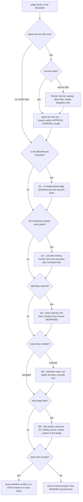

# SEVER — Hostile-Judge Q&A Armor

**TL;DR** — Twelve hardest questions: a ≤40-word answer each, the receipts that make it defensible, and — where genuinely weak — an honest admission that doesn't sink the pitch. Policy: never claim a number without a receipt; concede fast, then redirect to what IS measured. All numbers regenerable from `docs/receipts/` or the live scripts.

Provenance: written against origin/main `7a30ede` on branch `audit4/judge-sim`; every cited receipt was opened and every Q9 number recomputed from `scale_wall.json` (5.44MB/tenant, 53.1GB @10K, 6,023-tenant 32GB ceiling, 9.4h single-stream load). The test suite was executed live on that branch: 377 collected, 0 failures, 164 engine-skips (no docker on the audit host); two receipts contained audit-caught warts (README "~460 green" badge vs 377 collected; `GRAPH.MEMORY` per-graph zeros).

**Refreshed 2026-10-16 on `audit6/docs-core` (develop tip `12d1392`):** the suite was re-executed live — **454 collected, 278 passed + 176 engine-skips, 0 failures in 61.21s** (receipt: [`docs/receipts/test_suite_2026-10-16.json`](receipts/test_suite_2026-10-16.json)); the README badge now states the measured count instead of "~400 green". The `GRAPH.MEMORY` per-graph zeros wart remains live in `scale_wall.json` (`per_graph_mb_mean: 0.0` — falkordb 6.0.0 MB-precision parse) — quote `docker_rss: 1.594GiB`, not the per-graph zeros.

## The judge's likely exploration path

## 1. "Isn't this BloodHound rehosted?"
**A:** No. We never run BloodHound — we re-implement its edge semantics in FalkorDB Cypher and add what it lacks: findings-reactive loop, human-gated cuts, re-measured before/after receipts, cross-process case memory. Collectors and sample data are credited.
**Receipts:** `receipts_live_sever_demo.json` (executed cuts, 2.28ms re-query); `ablation.json` (graph 5/5 vs keyword 0/5); ETL fidelity 1,480 nodes / 12,450 edges / zero dangling vs the real sample (`tests/test_etl.py`, 62 tests).
**If pressed:** the semantics are deliberately BloodHound-faithful — that's the sensor layer, Apache-2.0 credited. The product is the interdiction loop built on it, which BloodHound does not have.

## 2. "BloodHound Enterprise already ranks attack paths — what's new?"
**A:** BH Enterprise stops at advice — rankings and risk scores for humans to execute. SEVER closes the loop: finding → ranked cut → human gate → executed sever → re-queried verdict, receipted in milliseconds. Ranking theory isn't ours; the measured interdiction loop is.
**Receipts:** `docs/CYPHER.md` (exact load-bearing queries); `receipts_T2_live.json` (gated cut 2.47ms after cross-process resume); `receipts_hybrid_live.json` (bridge cut 1→0 @ 3.0ms).
**If pressed:** concede ranking novelty entirely — edge scoring is BH's published work. Redirect: no BH product executes remediation with measured before/after; even SpecterOps keeps its own agentic tooling read-only (our README §10).

## 3. "The greedy ranking isn't optimal — why should we care?"
**A:** Correct, and we never claim optimal: optimal multi-edge interdiction is NP-hard. Greedy re-ranks on the live mutated graph each round — receipts prove outcomes: cut #1 honestly DEGRADED (1→1), cut #2 COLLAPSED (1→0 @2.28ms). Measured beats claimed.
**Receipts:** `sever/core/scoring.py` math-honesty header (supermodular objective, no classic greedy guarantee, cites Israeli & Wood 2002); `tests/test_live_interdiction_invariants.py` pins cut-never-increases and verdict coupling.
**If pressed:** no approximation bound exists for our re-enumerating greedy — documented in source. Guaranteed instead: every verdict is a re-measured claim, never an extrapolation.

## 4. "The LLM does nothing load-bearing — why call it an agent?"
**A:** An agent acts on an environment; the LLM narrates. SEVER's agent perceives findings, triages, proposes, executes gated cuts, verifies — a perceive/act loop with measured effects. The LLM seam is deliberately optional (ResilientLLM); determinism is a feature, not a gap.
**Receipts:** `sever/agent/investigator.py` (the loop); `sever/agent/llm.py` (degradation latch, live-verified against a rejected key); `ablation.json` proves the graph, not the model, answers estate questions.
**If pressed:** no autonomous planning, by design — the human gate is the point. An agent that severs AD edges ungated is a liability, not a feature.

## 5. "Why FalkorDB and not Neo4j?"
**A:** Native multi-tenancy: 300 isolated tenant graphs in one instance at 1.59GiB RSS, queries flat at 4.67ms median. Neo4j Community is single-database; per-tenant isolation needs Enterprise. One engine also carries estate, scoring, receipts, and case memory — no second store.
**Receipts:** `scale_wall.json`; `profile.txt` (~1.1ms in-engine on the demo tenant, index-vs-scan planner analysis); `docs/CYPHER.md` (engine quirks mapped and documented, not hidden); one-command engine in `docker-compose.yml`.
**If pressed:** yes, it's the hackathon's host tech — but the case stands alone: graph-per-tenant isolation at 5.4MB/tenant, plus FalkorDBSaver puts case memory in the same substrate (Track 2).

## 6. "300 tenants is 300 copies of a tiny sample — is the scale real?"
**A:** Each tenant is a deterministic injective remap of the official sample — stated in the code. What's real: one engine holding 444K nodes / 3.7M edges in 1.59GiB with flat 4.67ms queries. We claim substrate scale, not estate diversity — honestly.
**Receipts:** `sever/synth/tenants.py` (injective SID shift ×10^15, uuid5 remaps; `tests/test_synth.py`); `scale_wall.json` (flat p95 4.81ms); `docs/INCIDENTS.md` (Snowflake-style multi-tenant CSPM is the target shape).
**If pressed:** concede homogeneity fully — the wall proves the platform (multi-tenancy, memory, isolation), not estate variety. A heterogeneous-shape load is prep item #2.

## 7. "The demo API is unauthenticated — is this production-anything?"
**A:** It's a public demo by design: synthetic estate, no real data, mutations confined to the demo tenant, auto-reload on boot. Hardened: 1MB cap, security headers, CORS fail-closed, parameterized Cypher. Production auth/RBAC is absent and documented — the honest boundary.
**Receipts:** `docs/security_audit.md` (full-history secrets scan clean, every interpolation seam tabled); `BodySizeLimitMiddleware` (413 before buffering); `render.yaml` (`sync: false`); 503 engine-outage JSON with failed-attempt receipts.
**If pressed:** no operator authn/authz, and `approved_by` is recorded but unverified. For a synthetic-data demo this is a scoped decision, not an oversight — the engine behind it is credential-protected.

## 8. "Sample data is synthetic — what happens on a real 100K-identity estate?"
**A:** ETL parses the real collector formats, fidelity-pinned to the sample: 1,480/12,450, zero dangling, hostile input fail-loud. Traversal receipts exist to 444K nodes. Rank quality on real estates is unproven — claimed nowhere; the UI labels the estate simulated.
**Receipts:** `tests/test_etl.py` + `tests/test_hostile_etl.py` (real BloodHound CE/AzureHound formats, never invent unresolved principals); `scale_wall.json` (444K-node traversals); on-screen "simulated estate" label (README §11).
**If pressed:** no real-estate validation exists; we make no such claim. Two real-data hazards already handled: unresolved-principal materialization and tie-set blowup (15–25s/pair, offline mode only).

## 9. "What breaks first at 10K tenants / 1M identities?"
**A:** In order: RAM (~5.4MB/tenant ⇒ ~54GB, past our 32GB host at ~6K tenants — shard per-tenant graphs, trivially); then load stream (3.39s/tenant single-connection ⇒ parallelize); then proposal scoring — edge_frequency is O(owned×jewels) per-pair queries. Reachability is already all-pairs, two queries.
**Receipts:** `scale_wall.json` (1.594GiB/300 = 5.44MB per tenant; mean load 3.391s); `sever/core/falkor_port.py` (two-arm all-pairs reachability, O(2) queries @60s timeout vs per-pair `paths_to_jewels` @30s each).
**If pressed:** 10K tenants ≈ 53.1GB RSS → shard or bigger host; per-tenant graphs make sharding trivial. A 1M-identity single estate is only ~3.6GB — its breaker is scoring fan-out, not storage.

## 10. "Is case memory in FalkorDBSaver actually novel or just langchain plumbing?"
**A:** The saver is off-the-shelf plumbing. The value is what it checkpoints: the human-gate decision survives process death, resume cannot bypass the gate (fails closed), and case memory lives in the same engine as the estate — kill-9, isolation, and lock receipts.
**Receipts:** `docs/receipts/audit3_mem/` (interleaved case-A/B isolation, taskkill mid-case, `DEL checkpoints` fails closed); `tests/test_caselog_atomicity.py` (cross-process lock; 5–13% event loss fixed); `receipts_T2_live.json` (2.47ms); `docs/T2_MEMORY.md` honest-boundary section.
**If pressed:** concede the saver package itself (langchain-falkordb 0.2.0). We claim co-location — one engine for world-model + memory — and gate-state persistence under adversarial verification, not a novel checkpointer.

## 11. "What would you build with 3 more weeks?"
**A:** One: a heterogeneous real-estate load — non-uniform tenant shapes at 100K identities, with receipts. Two: console auth/RBAC with signed gate approvals tied to operator identity. Three: richer interdiction vocabulary — multi-edge remediation bundles, rollback receipts, more Entra/ADCS abuse chains.
**Receipts:** each item names its current gap honestly (Q6/Q8, Q7, Q3) and extends a receipted core — nothing speculative is asked for first. ADCS already partly present (`MANAGE_CA`/`MANAGE_CERTIFICATES` traverse).
**If pressed:** priorities ordered by judge risk: heterogeneous load receipt defuses the two hardest questions; auth makes the loop enterprise-credible; vocabulary widens real-incident coverage.

## 12. "Why should this WIN over a GraphRAG/agent-memory entry?"
**A:** Rule 3, quantified: remove FalkorDB and nothing runs — the ablation shows graph traversal answering 5/5 where text retrieval answers 0/5. The graph acts, not decorates: gated cuts with measured before/after. And the memory serves a shift-handoff job, with adversarial receipts.
**Receipts:** `ablation.json`; `scale_wall.json` (multi-tenancy made real, not described); `audit3_mem/` (memory attacked, not just shown); 454 collected tests, 0 failures; honest DEGRADED verdicts on camera.
**If pressed:** differentiation is verifiability — every headline claim has a JSON receipt or a reproducible script. A GraphRAG demo's quality varies with the model; ours is deterministic.

## Delivery rules for the room

- Concede first, then redirect to a receipt — a fast honest "correct, and here's why it doesn't matter" beats a defensive hedge every time.
- Never say a number that isn't on the cheat-sheet below; if pressed for one we don't have, say "unmeasured — here's how we'd measure it."
- Never claim optimal, production, real-data, or scale beyond the receipts — the docs already don't; the room must not either.
- The DEGRADED 1→1 cut is the trust artifact: show it unprompted. A product that reports its own failed cut on camera earns the benefit of the doubt everywhere else.
- If a judge quotes our own code back at us (`synth/tenants.py`, `OfflineNarrator`), agree immediately and finish the sentence with what it buys us.

## The 3 most dangerous questions (ranked)

1. **Q2 — "BH Enterprise already ranks attack paths."** The existential novelty attack: if it lands, every receipt reads as "nice rehost." Armor: advice-vs-executed-loop framing, then concede ranking theory explicitly — never defend what isn't ours.
   *Follow-up it invites:* "So your only novelty is a delete query?" — counter: the loop is finding-reactive re-scoring on a mutated graph, a human gate that survives process death, and receipts that re-measure; a delete is stateless, none of that is.
2. **Q6 — "300 copies of a tiny sample."** The admission sits in our own `sever/synth/tenants.py` — a judge who reads code finds it in 60 seconds. Concede before they say it: "substrate scale, not estate diversity."
   *Follow-up it invites:* "So the 4.67ms says nothing about real estates?" — counter: it says the engine stays flat across tenant count; estate-shape sensitivity is a different axis, and that receipt is exactly prep item #2.
3. **Q8 — "What happens on a real estate?"** No real-data receipt exists; unprepared it becomes Q6+Q9 combined. Concede rank-quality is unproven; hold the ETL-fidelity line (real formats, fail-loud, never invent data).
   *Follow-up it invites:* "So it could rank cuts badly on real data?" — counter: the verdict system is the hedge: a bad ranking surfaces as DEGRADED or no_effect in the receipt, never as a false COLLAPSED.

## PREP before judging

1. **10K-tenant extrapolation note** (one page, cite in Q9): RAM 5.44MB/tenant ⇒ 53.1GB @10K (32GB host ceiling ≈ 6,023 tenants); load 3.391s/tenant single-stream ⇒ 9.4h ⇒ parallel-connection plan; edge_frequency fan-out O(owned×jewels).
2. **Heterogeneous-estate load receipt**: vary tenant shapes/densities (or a larger public AD dataset), ≥100K nodes, re-run the latency sample — defuses Q6 and Q8 in one artifact.
3. **Test-count receipt** — refreshed 2026-10-16, no longer a wart: live DB-free run at the develop tip is 454 collected / 278 passed / 176 engine-skips / 0 failures (61.21s; [`docs/receipts/test_suite_2026-10-16.json`](receipts/test_suite_2026-10-16.json)); the README badge now carries the measured count. If an engine-up host is free before judging, print the full green run to turn the 176 skips into passes on camera.
4. **GRAPH.MEMORY zeros footnote**: `scale_wall.json` per-graph MB reads 0.0 on falkordb 6.0.0 (MB-precision parse) — keep the one-line quirk note; lead with `docker_rss: 1.594GiB`.
5. **BloodHound Enterprise cheat-sheet**: three bullets on what BE does/doesn't (advice-only, no gated execution, no re-measured receipts), citing SpecterOps's own read-only-agents stance (our README §10).
6. **Live-URL cold-start drill**: Render free-tier spin-up (~50s) + keepalive; rehearse the hero arc with the receipts page open; screenshot the 503 containment JSON as the engine-down fallback. Rehearse the DEGRADED arc — the honest 1→1 cut is the trust spike, don't hide it.

## Receipt cheat-sheet (quote from memory)

| Number | Source |
|---|---|
| 1,480 nodes / 12,450 edges / 0 dangling | ETL vs official sample, `tests/test_etl.py` |
| Cut #1 DEGRADED 1→1; cut #2 COLLAPSED 1→0 @ 2.28ms | `receipts_live_sever_demo.json` |
| Fresh-process resume, cut @ 2.47ms | `receipts_T2_live.json` |
| Hybrid 14,422 nodes / 9 bridges, bridge cut 1→0 @ 3.0ms | `receipts_hybrid_live.json` |
| 300 tenants / 444K nodes / 3.735M edges / 1.594GiB RSS | `scale_wall.json` |
| 4.67ms median, 4.81ms p95, 4.98ms max — flat | `scale_wall.json` |
| ~1.1ms in-engine canonical query | `profile.txt` |
| Ablation: graph 5/5 vs keyword 0/5 | `ablation.json` |
| Cloud load 16.8s, hero arc COLLAPSED | `receipts_cloud_live.json` |
| 454 tests collected, 0 failures (278 pass + 176 engine-skips local) | live `pytest` run, `docs/receipts/test_suite_2026-10-16.json` |
| 43 traversal rels, hop cap 12; 28 labels / 42 edge families | `docs/CYPHER.md`, `docs/GRAPH_MODEL.md` |
