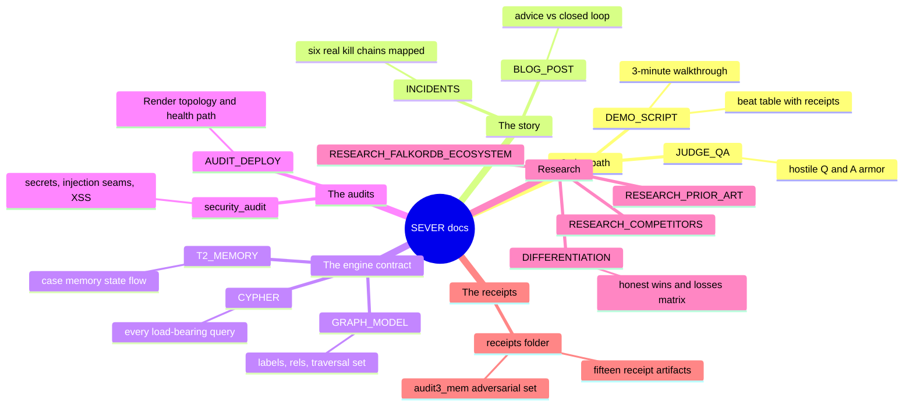

# SEVER — Documentation Index

Everything in `docs/` is receipts-first: every load-bearing number in these pages
traces to a JSON/text artifact under [`receipts/`](receipts/) that was captured on
the live engine. The root [`../README.md`](../README.md) is the product pitch and
architecture; this page is the map of the supporting documents.

> **TL;DR** — Judges: read [DEMO_SCRIPT.md](DEMO_SCRIPT.md) (walkthrough + beat
> table), then [JUDGE_QA.md](JUDGE_QA.md). Story: [BLOG_POST.md](BLOG_POST.md) and
> [INCIDENTS.md](INCIDENTS.md) (six real kill chains mapped to SEVER beats). Tech
> contract: [GRAPH_MODEL.md](GRAPH_MODEL.md), [CYPHER.md](CYPHER.md),
> [T2_MEMORY.md](T2_MEMORY.md). Audits: [AUDIT_DEPLOY.md](AUDIT_DEPLOY.md),
> [security_audit.md](security_audit.md). Evidence: [`receipts/`](receipts/).

## The documentation map

## Doc-by-doc

| Doc | What it holds | Start here when |
|---|---|---|
| [DEMO_SCRIPT.md](DEMO_SCRIPT.md) | the 3-minute judge walkthrough: sequence diagram, beat table with exact clicks, verbatim banners, receipt-traced timings, fallback ladder | you are about to demo SEVER or record the video |
| [JUDGE_QA.md](JUDGE_QA.md) | hostile-question armor: the twelve kill questions with receipt-backed answers | a judge asks "isn't this just BloodHound rehosted?" |
| [BLOG_POST.md](BLOG_POST.md) | the essay: advice-only tools vs SEVER's closed loop, honest architecture, FalkorDB 6.0.0 lessons | you want the narrative or the blog track |
| [INCIDENTS.md](INCIDENTS.md) | six real kill chains (Storm-0558, MGM, Snowflake, DCSync, Kerberoasting, shadow-admin ACE) mapped to SEVER beats, one flowchart each | you want the "why this matters" story with real incidents |
| [GRAPH_MODEL.md](GRAPH_MODEL.md) | node labels, relationship types, the traversal set, hybrid Entra overlay, multi-tenancy | you need the data model behind every query |
| [CYPHER.md](CYPHER.md) | every load-bearing Cypher query verbatim, plus the engine quirks mapped during the build | you want the exact Cypher the product depends on (a rules requirement) |
| [T2_MEMORY.md](T2_MEMORY.md) | the Track 2 case-memory story: state diagram (finding → checkpoint → resume), key-focus map, audit3 adversarial verification | you care about agent memory and cross-process resume |
| [AUDIT_DEPLOY.md](AUDIT_DEPLOY.md) | the Render deployment audit: deploy history, ephemeral-ledger reality, health-check fix, keepalive, deployment-topology diagram | you are deploying, or asking "what breaks on the free tier?" |
| [security_audit.md](security_audit.md) | secrets scan, every Cypher-injection seam, request schemas, port exposure, DOM XSS, the plaintext engine leg | you are doing a security review of this repo |
| [RESEARCH_COMPETITORS.md](RESEARCH_COMPETITORS.md) | the competitor landscape with one URL per claim and the gap matrix | you ask who else closes the interdiction loop |
| [DIFFERENTIATION.md](DIFFERENTIATION.md) | SEVER vs everything — the honest matrix: where SEVER sits (advice vs executed-and-receipted), where it honestly loses, the honest delta | you need the one-picture answer to "how is this different from BloodHound and the commercial players?" |
| [RESEARCH_FALKORDB_ECOSYSTEM.md](RESEARCH_FALKORDB_ECOSYSTEM.md) | the sponsors' own positioning, flagship features receipted at scale, past-winner formula, judge talking points | you are prepping the host/judge conversation |
| [RESEARCH_PRIOR_ART.md](RESEARCH_PRIOR_ART.md) | academic prior-art search: CNP/CEP, AD hardening, graph-DB agents, detectability ranking | you ask "has this already been built or published?" |

## The receipts (`docs/receipts/`)

The evidence layer. Numbers in the docs above cite these; the JSON on the branch is
the source of truth.

| Receipt | Proves | Key numbers |
|---|---|---|
| [`receipts/receipts_live_sever_demo.json`](receipts/receipts_live_sever_demo.json) | the hero arc: F-001…F-004 case log + gated cut cascade | 1,480n / 12,450e tenant; cuts 2.34ms `degraded` → 2.28ms `collapsed` (1 → 0) |
| [`receipts/receipts_hybrid_live.json`](receipts/receipts_hybrid_live.json) | merged AD+Entra estate and the `SYNCED_TO` bridge cut | 14,422n / 29,191e / 9 bridges; cut 1 → 0 @ 3.0ms |
| [`receipts/receipts_T2_live.json`](receipts/receipts_T2_live.json) | cross-process case-memory resume (`case-DB-01`) | gated cut 1 → 0 @ 2.47ms, `state_step: verified` |
| [`receipts/plan_receipt.json`](receipts/plan_receipt.json) | k-cut plan projected on an isolated `GRAPH.COPY`, then executed step-wise | plan ~0.96s; collateral-aware proposal ~0.90s; executed step `collapsed`, no drift |
| [`receipts/scale_wall.json`](receipts/scale_wall.json) | the multi-tenant scale wall | 300 tenants / 444,000 nodes / 3,735,000 edges / 1.594 GiB / median 4.67ms (p95 4.81ms, flat) |
| [`receipts/ablation.json`](receipts/ablation.json) | graph traversal vs keyword-only retrieval, live engine | graph 5/5 vs keyword 0/5 |
| [`receipts/profile.txt`](receipts/profile.txt) | in-engine `GRAPH.PROFILE` receipt (falkordb 6.0.0) | canonical path query median 1.13ms; point lookups ~0.26ms |
| [`receipts/receipts_cloud_live.json`](receipts/receipts_cloud_live.json) | the hero arc on FalkorDB Cloud free tier (ap-south-1) | 16.75s over-the-wire auto-load; final reachability 0 |
| [`receipts/audit5_cloud_instance.json`](receipts/audit5_cloud_instance.json) | live Cloud instance probe: modules, memory ceiling, ACL surface | engine v4.22.0; 100 MiB maxmemory; CONFIG/ACL/KEYS/DEBUG/SAVE denied |
| [`receipts/audit3_mem/`](receipts/audit3_mem/) | memory-flow adversarial verification: interleaved-case isolation, kill-9 durability, `DEL` fail-closed, concurrent ledger | fresh-process resume verbatim: "triage was remembered from case memory" |
| [`receipts/perf_audit7_client_roundtrips.json`](receipts/perf_audit7_client_roundtrips.json) | the audit7 client-layer fold receipts: identical driver run before/after on both engines | `/api/state` 11 → 2 round-trips; state median 7.9ms → 1.2ms (ryzen) |
| [`receipts/perf_plan_equivalence.json`](receipts/perf_plan_equivalence.json) | plan hot-path equivalence on the self-hosted engine: old two-arm vs per-pair vs batched seam (identical plan output) | k=3 plan medians 220.8ms → 217.6ms → 108.4ms |
| [`receipts/perf_cloud_before_develop.json`](receipts/perf_cloud_before_develop.json) | production console (develop code) `GET /api/plan` against the Cloud free-tier engine — the BEFORE of the cloud latency story | median 13,505ms over the wire (p95 13,549ms) |
| [`receipts/perf_cloud_plan.json`](receipts/perf_cloud_plan.json) | the same cloud `/api/plan` endpoint: owner-reported 13-14s repro matched, plus derived after-predictions for the branch | before median 13.5s; predicted ~12.6s standalone scoring path |
| [`receipts/test_suite_2026-10-16.json`](receipts/test_suite_2026-10-16.json) | the test-count receipt behind the README badge (live DB-free run at the develop tip) | 454 collected / 278 passed / 176 engine-skips / 0 failed in 61.21s |

## Reading order for a judge with ten minutes

1. [`DEMO_SCRIPT.md`](DEMO_SCRIPT.md) — the walkthrough diagram and the beat table.
2. [`INCIDENTS.md`](INCIDENTS.md) — the real-incident mapping (skim the diagrams).
3. [`JUDGE_QA.md`](JUDGE_QA.md) — the kill questions, answered with receipts.
4. Any receipt in [`receipts/`](receipts/) that a claim cites — open it and check.
