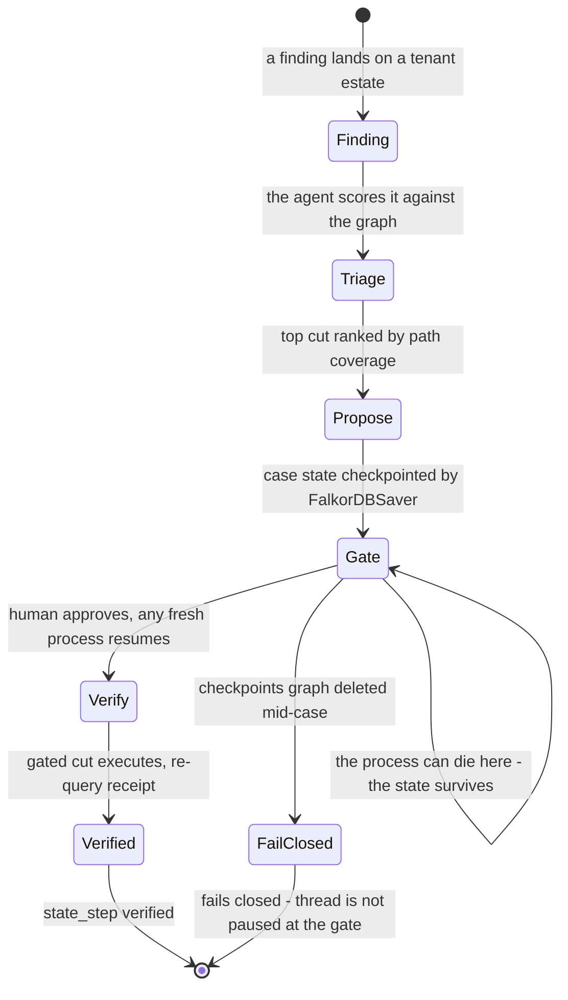

# SEVER × Track 2: Agent Memory and Coordination

> **TL;DR** — SEVER's case memory is the investigation itself, checkpointed in the
> same engine that holds the estate: LangGraph flows saved by **FalkorDBSaver**, one
> checkpoint graph per tenant. A killed process resumes with zero re-explanation
> (fresh-process resume lands the gated cut **1 → 0 in 2.47ms**, `state_step:
> verified`); interleaved cases never cross-contaminate; a deleted checkpoints graph
> fails **closed**. The five key-focus bullets map one-to-one below — flow diagram
> first, then the map, then the adversarial verification that re-attacked every claim.

## The case-memory flow — finding → checkpoint → resume

Receipts: fresh-process resume and cut at 2.47ms
([`receipts_T2_live.json`](receipts/receipts_T2_live.json)); kill-9 durability,
isolation, DEL-fail-closed and concurrency receipts under
[`receipts/audit3_mem/`](receipts/audit3_mem/) — regenerate with
`python scripts/audit3_memory_audit.py <beat>`.

## Track 2 key-focus map

Track 2 asks for agents that "remember across sessions and share state with
each other," with five key-focus bullets. Here is exactly how SEVER's case
memory satisfies each — and where it deliberately doesn't claim.

| Key focus | SEVER's implementation | Receipt |
|---|---|---|
| **Episodic / semantic / procedural memory** | **Episodic**: every finding, triage result, proposal and gate decision is an event in the thread state (`sever/memory/flow.py`, `InvestigationState`). **Semantic**: the estate itself — principals, rights, paths — is the shared world model in the tenant graph. **Procedural**: the triage→propose→gate→verify flow is the encoded procedure every process follows on resume. | `docs/receipts/receipts_T2_live.json` |
| **Persistent conversation history** | Investigations are LangGraph flows checkpointed by **FalkorDBSaver** — state lives IN the graph database, one graph per case namespace; a killed process resumes with zero re-explanation. | live run: process 1 paused at the gate, process 2 (fresh) resumed and cut — 2.47ms re-query |
| **Shared state and handoffs between agents** | Any process (or second agent role) connecting to the same graph + checkpointer sees the same case state — the night-shift handoff. The `CaseLog` ledger is the append-only audit trail all participants share (multi-PROCESS-locked appends, audit3-verified). | `sever/memory/flow.py::CaseLog`; `tests/test_memory.py::test_kill9_resume_from_fresh_flow_object`; `docs/receipts/audit3_mem/` |
| **High-concurrency reads/writes** | FalkorDB is the substrate: MVCC engine, read replicas via `GRAPH.RO_QUERY`, per-tenant graph isolation. Scale receipts: 300 concurrent tenant graphs, queries flat at a 4.67ms median. | `docs/receipts/scale_wall.json` |
| **Separate memory per user or tenant** | Native FalkorDB multi-tenancy: case checkpoints live in `sever_<tenant>_checkpoints` graphs; estate in `sever_<tenant>`; identity remaps are injective so tenants share zero objectids. | `sever/memory/flow.py::_checkpointer`; `tests/test_synth.py` |

## Honest boundary

**Honest boundary**: procedural memory is the fixed investigation flow — we do
not claim learned remediation policies. Cross-graph single-query is not used
(per FalkorDB's engine design); cross-tenant coordination happens through the
shared ledger pattern, demonstrated process-to-process.

## Why this qualifies

**Why this qualifies**: the memory exists to serve a job — a shift-handoff
interdiction case — not as a memory demo for its own sake. The same database
that stores the estate runs the case memory, the scoring, and the receipts.

## Adversarial verification — audit3/memory-flow

**audit3/memory-flow adversarial verification** — every claim above was
re-attacked live on the engine (receipts: `docs/receipts/audit3_mem/`,
regenerate with `python scripts/audit3_memory_audit.py <beat>`): case-A and
case-B interleaved on ONE graph + checkpointer never cross-contaminate (each
resume remembered its own checkpointed finding/subject/proposal and executed
its own stored top proposal); a `taskkill /F` of the operator console and the
paused case holder mid-case loses nothing (a fresh process resumed the exact
pre-kill stored proposal); `DEL sever_audit3_mem_checkpoints` mid-case fails
CLOSED (`ValueError: thread ... is not paused at the gate` — never a
wrong/empty resume, never a minted investigation, no cut executed); and the
tenant CaseLog under two concurrent console PROCESSES keeps every line valid
JSON (before audit3 the unlocked append lost 5-13% of events on Windows —
fixed with a cross-process-locked append/read). Doc numbers re-verified
against receipts: 2.47ms re-query (`docs/receipts/receipts_T2_live.json`),
300 tenants / 4.67ms median (`docs/receipts/scale_wall.json`).
