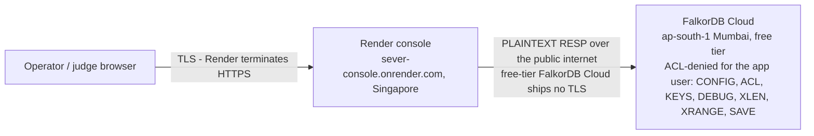

# Security audit — branch `audit/security`

Scope: SEVER (console + engine ports + ETL + agent). Base: 5c97c46.
Method: full `git log -p --all` secrets scan (4.7 MB, every ref), line-by-line
review of every string-interpolation seam into Cypher, pydantic schema review,
docker-compose exposure review, DOM-sink review of the console UI. Every
verdict below is backed by a regression test in this branch.

> **TL;DR** — Secrets: **clean** across all refs (zero real hits, no `.env` ever
> committed). Cypher injection: every interpolation seam inventoried (§2 table),
> three real gaps closed on this branch (batch-rel gate, regex anchor, charset);
> the one interpolated slot left (`{rel}`) is regex-validated before reaching the
> query string. Request schemas hardened at the HTTP layer (§3). Console XSS fixed
> at the DOM boundary (§5). One accepted-surface list documented by design, and the
> live deployment's plaintext engine leg flagged honestly (§4b — diagram below).
> Tests: **52 passed, 38 skipped (engine-gated), 1 pre-existing failure**.

## 0. Transport topology — where the plaintext leg is

What crosses the plaintext leg: the `AUTH` handshake, every Cypher query, and all
graph data — read-limiting ACLs (measured live in
[`receipts/audit5_cloud_instance.json`](receipts/audit5_cloud_instance.json))
constrain what a stolen credential can *do*, but do not encrypt it. Self-hosted
deployments close the gap by pointing `SEVER_FALKOR_HOST` at localhost or a
private network.

## 1. Secrets — CLEAN

- Full-history scan (all refs, `git log -p --all`), 12 pattern families:
  GitHub tokens (`ghp_/gho_/ghs_/ghu_/ghr_/github_pat_`), AWS `AKIA…`,
  OpenAI `sk-…`, Google `AIza…`, Slack `xox…`, private-key blocks, JWTs,
  bearer tokens, URLs with embedded credentials, and password/secret/token/
  api_key assignments. **Zero real hits.** The 11 keyword matches are all
  benign code shapes (`os.environ.get("SEVER_LLM_API_KEY")`, kwarg names,
  a UI-forms CSV row).
- Watch-list literals across the entire history: `JJ6Z` = 0, `BZEPCC` = 0,
  `ghp_` = 0, `gho_` = 0, `ghs_` = 0, `github_pat_` = 0.
- `git fsck --unreachable` — no dangling objects to leak from.
- `.gitignore` covers `.env`, `.secrets/`, `*.key`. Filename audit of every
  path ever committed: only `.env.example` ever existed, and its values are
  empty placeholders. **No `.env` was ever committed.**
- `docs/receipts/*.json` / `profile.txt`: only identifiers from the public
  Apache-2.0 SpecterOps sample estate (GUIDs/SIDs) — no credentials.

## 2. Cypher injection — every seam verified, three gaps closed

Every place a string reaches a query text (complete inventory):

| Interpolation point | Verdict |
|---|---|
| `falkor_port.add_edge` / `cut` rel → `.format(rel=…)` | guarded by `_valid_rel` ✓ |
| `falkor_port` PATH/CANONICAL templates `.format(pattern=…)` | constants + int hop_cap, no user input ✓ |
| `falkor_port` `CREATE INDEX … (n:{label})` | `INDEXED_LABELS` class constant ✓ |
| `cypher_batches.node_batches` label → `MERGE (n:{label}…)` | closed vocabulary `TYPE_LABEL`/`_KNOWN_LABELS`, never record content ✓ (+ regression test) |
| `cypher_batches.edge_batches` rel → `MERGE (s)-[r:{rel}…]` | **was UNGUARDED — fixed** (below) |
| console `FindingRequest.kind/subject/target` | `subject`/`target` ride `$oid`/`$target`/`$o` params everywhere (`mark_owned`, `paths_to_jewels`, `_name`, ADD_EDGE `$src/$dst/$props`); `kind` is only a dict key (`ATTACK_MAP.get`) + LLM prompt text ✓ |
| `scoring.interdict` → `port.cut` | `_valid_rel` ✓ |
| `flow.verify_node` → `approve_and_cut` | `_valid_rel` via `cut` ✓ |
| `ablation.keyword_hits` `{clauses}` | `$`-numbered params, terms hardcoded in-file ✓ |
| `scripts/scale_wall.py` pattern | constants ✓ |

Fixed on this branch:

1. **Batch rel gate (the real gap).** AD edge rels are derived from collector
   *data-file* content (`Aces[].RightName` → `_right_to_rel`) — not a closed
   enum — and were interpolated into `MERGE (s)-[r:{rel} …]` with no guard. A
   hostile/malformed BloodHound JSON could inject Cypher in the load path.
   `edge_batches` now fail-loud rejects any rel outside
   `^[A-Za-z][A-Za-z0-9_]{0,63}\Z`. Verified against the real sample estate:
   28 AD + 3 Entra rel types, zero violations, all batches still emit.
2. **`_valid_rel` anchor.** Python `$` also matches before a trailing newline,
   so `"MEMBER_OF\n"` passed the guard. Now `\Z` (caught by this audit's own
   regression test).
3. **`_valid_rel` charset.** It rejected the product's own camelCase Entra rels
   (`AZOwns`, `AZMemberOf`, `AZVMAdminLogin`… are in `TRAVERSAL_RELS`), which
   would 500 any Entra finding that granted an edge. Widened to
   `[A-Za-z][A-Za-z0-9_]` — still injection-proof: that charset contains no
   Cypher metacharacter, so a valid rel can never escape the `-[r:{rel}]->`
   slot.

Accepted surfaces (documented, by design for a local operator tool):
`profile()` passes a raw query through (operator-only), `finding.subject`
text reaches the LLM narration prompt (display-only output), `CaseLog`'s
path derives from the operator's `SEVER_FALKOR_GRAPH` env.

## 3. Console request schemas (task 3)

`CutRequest`/`FindingRequest` moved to `sever/console/schemas.py` (pure
pydantic, engine-free import — `app.py` connects to FalkorDB at import time,
so the models were previously untestable without an engine) and hardened:

- size caps: `src/dst/subject/target` ≤ 256, `rel` ≤ 64, `kind` ≤ 64,
  `approved_by` ≤ 128 — absurd payloads die as HTTP 422;
- `rel` carries the same `^[A-Za-z][A-Za-z0-9_]{0,63}$` syntax pattern as the
  port guard, so injection payloads are rejected at the HTTP layer before
  any query template exists.

Verified by `tests/test_console_schemas.py` (10 engine-free model tests:
oversized fields, injection rels, trailing-newline rel, camelCase rels
accepted, valid requests accepted) plus an end-to-end 422 test in
`tests/test_console.py` (engine-gated).

## 4. docker-compose port exposure (task 4)

`"6379:6379"` and `"3000:3000"` bind **all interfaces** (0.0.0.0), and
FalkorDB RESP ships with **no authentication** by default — anyone who can
reach the host can read, mutate, or `GRAPH.DELETE` every tenant graph; the
browser UI exposes the same data. Flagged in-file with a SECURITY NOTE
(loopback-bind guidance). **Ports left unchanged per audit scope.**

## 4b. The live deployment's plaintext engine leg (added by audit5/cloud-instance)

Scope note for completeness: this audit scoped the app surface; the LIVE
deployment adds one infra-leg gap outside its original scope. Free-tier
FalkorDB Cloud ships **no TLS** (TLS begins at the paid Startup tier), so the
Render console talks to the engine in **plaintext RESP over the public
internet** — the AUTH credential, every Cypher query, and all graph data are
on-path-readable (and the engine's RESP port is internet-facing, protected
only by that credential — note the ACL surface measured live in
`docs/receipts/audit5_cloud_instance.json`: `CONFIG`, `ACL`, `KEYS`, `DEBUG`,
stream reads (`XLEN`/`XRANGE`) and `SAVE` are all denied for the app user,
which limits what a stolen credential can do, but does not encrypt it).
Browser→Render IS TLS (Render terminates HTTPS); only the backend leg is
plaintext. Documented honestly in README §6 "Free-tier reality" and §11
"Transport — the one plaintext leg".

## 5. Console UI DOM XSS (found during the injection sweep)

`index.html` inserted graph-derived strings (node names, objectids, rel
types — all ultimately from collector data files) into `innerHTML`, and built
the APPROVE-CUT `onclick` by string concatenation. A hostile sample file
could execute script in the operator's browser and — worse — forge the
approval click (`POST /api/cut` with `approved: true`). Fixed with an
`esc()` boundary and a two-layer onclick encoding (JSON for the JS layer +
entity-encoding for the HTML attribute layer). **Browser-verified** against
live payloads (``, `<script>`, quote-breakouts): no execution,
payloads render as escaped text, the onclick attribute stays intact and
passes the exact original string.

## Test evidence

`pytest tests/`: **52 passed, 38 skipped, 1 pre-existing failure.**
The 38 skips are all `requires_engine` tests — this host currently has **no
FalkorDB** (port 6379 is serving plain Redis 7.4.7 with zero modules; docker
CLI unavailable in this shell). Re-run with `docker compose up -d` to
exercise the engine-gated suites, including this branch's end-to-end 422
test.

Pre-existing failure (not this branch, flagged for the Entra owner):
`tests/test_entra.py::test_merged_graph_bridges` asserts
`len(merged.nodes) > len(ad.nodes) + 1000`, but `merge_entra` mutates `ad`
in place and returns the same object — the assertion compares a dict with
itself and is impossible to satisfy. Identical at base commit 5c97c46.
Also fixed here (test-infra): `tests/test_console.py` teardown referenced an
undefined `port_obj` (NameError on every console test teardown).
